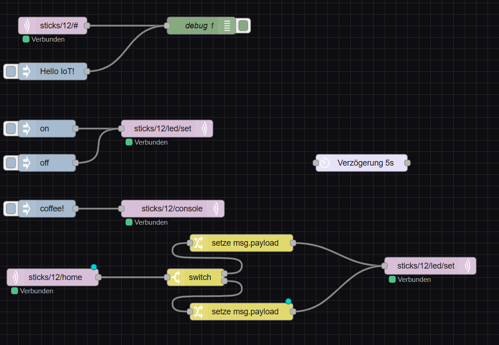
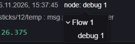
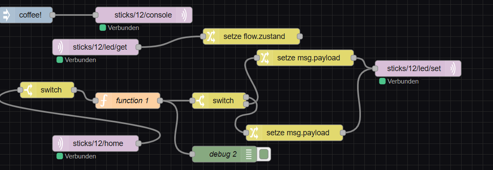
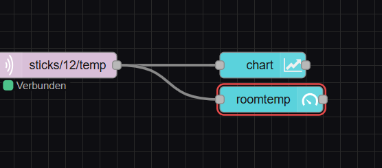
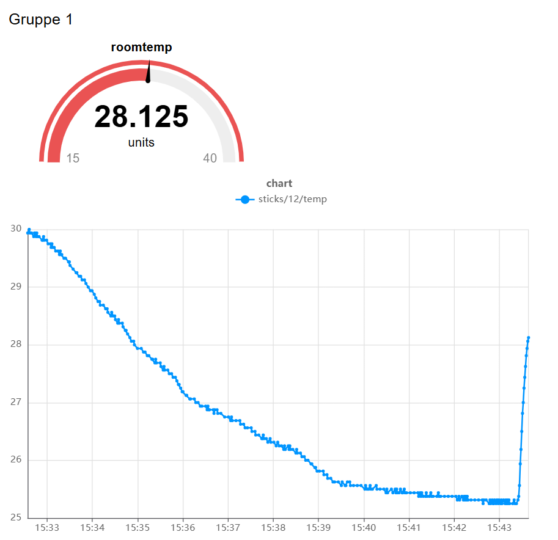
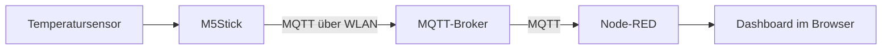

# Modul 1 – IoT-Grundlagen und Node-RED

**06.11.2026 · Notizen ergänzt am 14.11.2026**

Dieses Modul habe ich zusammen mit
[Jonas Prijic](https://github.com/OffBeatAtze/net-iot-hsbi-2026-portfolio)
bearbeitet. Unser gemeinsames Study log halte ich hier fest. Wir haben mit
Node-RED gearbeitet, die LED und das Display des M5Stick angesteuert und
die Werte eines selbst angeschlossenen Temperatursensors angezeigt.
Das Firmware-Update über WLAN hat unser Professor durchgeführt.

Die offenen praktischen Teile haben im Unterricht nicht mehr geklappt.
Danach haben wir dazu nur noch recherchiert. Diese Abschnitte sind als
Recherche gekennzeichnet und beschreiben, wie der Aufbau funktionieren sollte.

## Lernziele

Aus dem [Kursblatt](../materialien/hsbi-networking-iot-10d/modules/01-foundations-and-masterclass.md#-learning-goals).

<a id="lg1"></a>
### LG1 – Kurs

Explain how this class works — learning goals as the contract, negotiable tasks,
evidence in a portfolio — and start your own portfolio with a note on what you
already know, what you expect, and who your pod is.

**Nachweise:** [Einstieg aus der Pre-Study](#einstieg-aus-der-pre-study),
[Grundlagen im Pod](#task-1),
[Austausch mit einem anderen Pod](#task-2).

Beim Einstieg habe ich den MQTT-Versuch aus der Pre-Study mit unserem Aufbau
verglichen. Mit Jonas kam ein eigener Sensor dazu, und mit einem anderen Pod
habe ich verglichen, wie dessen Temperaturanzeige aufs Anfassen reagiert.

<a id="lg2"></a>
### LG2 – MQTT

Explain publish/subscribe with an MQTT broker: the star topology, hierarchical
topics, wildcards, and why decoupling producers from consumers is what makes an
IoT system maintainable.

**Nachweise:** [Grundlagen im Pod](#task-1),
[Nachrichten in Node-RED](#task-3),
[Taster, LED und Display](#task-4).

Im Node-RED-Flow habe ich am Filter `sticks/12/#` nachvollzogen, warum ein
Abonnement mehrere Topics desselben Sticks empfängt und der Sender die Empfänger
nicht kennen muss.

<a id="lg3"></a>
### LG3 – Node-RED

Build Node-RED flows that subscribe and publish, turn a physical button into a
remote actuator action, and render live telemetry as a gauge, a chart, and a
wildcard aggregation.

**Nachweise:** [Nachrichten in Node-RED](#task-3),
[Taster, LED und Display](#task-4),
[Verbindung zu einem anderen Pod (vorbereitet)](#task-5),
[Temperaturanzeige im Dashboard](#task-7).

Am Taster-Flow habe ich verstanden, wie aus einer eingehenden MQTT-Nachricht ein
Schaltbefehl für die LED wird. Die Wildcard-Aggregation und die Verbindung zum
anderen Pod habe ich anhand des geplanten Ablaufs erklärt.

<a id="lg4"></a>
### LG4 – OTA

Wire a digital 1-wire sensor, read its value over MQTT, and explain the
declarative OTA loop (one line in `setup.cpp` → a fleet-wide deployment) and what
it changes for a real fleet.

**Nachweise:** [Temperatursensor und OTA-Update](#task-6).

An den Messwerten in Node-RED habe ich gesehen, dass der in `setup.cpp`
eingetragene Sensor nach dem Update über WLAN Daten lieferte. Wie der Rollout an
eine ganze Geräteflotte funktioniert, bleibt im Bericht offen.

<a id="lg5"></a>
### LG5 – Schichten

Critically analyze the ISO/OSI 7-layer model against real TCP/IP in IoT systems
(referencing RFC 3439 and RFC 1958), and quantify header overhead from a capture
taken at the edge — the router, an ESP32 tap, or a provided dump — stating every
assumption.

**Nachweise:** [Grundlagen im Pod](#task-1),
[Header und Nutzdaten (Rechenbeispiel)](#task-8).

Im theoretischen Rechenbeispiel habe ich Header und Nutzdaten getrennt. So konnte
ich erklären, warum kleine Sensornachrichten relativ viel Overhead haben.

<a id="lg6"></a>
### LG6 – Systementwurf

Craft a system story that is concrete enough to pitch, spanning the computing
continuum with named stakeholders, devices, and interfaces — and name the weakest
link in it.

**Nachweise:** [Systemaufbau und Entwurf einer Systemgeschichte](#task-10).

Beim Entwurf der Raumklima-Anzeige habe ich den Weg vom Sensor bis zur Anzeige
gezeichnet und den Broker als Schwachstelle erkannt. Die Systemgeschichte liegt
als schriftlicher Entwurf vor.

## Einstieg aus der Pre-Study

**Lernziele:** [LG1](#lg1)

Beim [ersten MQTT-Test](../PreStudy/mqtt.md) habe ich meine eigene Nachricht
über einen öffentlichen Broker zurückbekommen. Sender und Empfänger konnten
also derselbe Client sein. In Modul 1 kam mit dem M5Stick ein eigenes Gerät
hinzu: Messwerte und Schaltbefehle liefen zwischen Stick und Node-RED.

## Study log

<a id="task-1"></a>
### Aufgabe 1 – Grundlagen im Pod

**Lernziele:** [LG1](#lg1), [LG2](#lg2), [LG5](#lg5)

#### Warm-up

Laptop, Smartphone und WLAN-Sensor sind Beispiele für vernetzte Geräte.
Für die Kommunikation über IP brauchen sie einen Netzzugang, eine passende
IP-Konfiguration und gemeinsame Protokolle.

Wenn Sensor und Anzeige im selben Gebäude sind, muss die Nachricht nicht
unbedingt über das Internet laufen. Ein lokaler Broker und eine lokale
Anzeige können den Weg im eigenen Netz halten. Ein Cloud-Broker würde
auch für diesen lokalen Anwendungsfall eine Internetverbindung voraussetzen.

Eine Schicht beschreibt eine Aufgabe im Netzwerkmodell. Ein Protokoll legt
fest, wie die Kommunikation tatsächlich abläuft. TCP ist zum Beispiel ein
Protokoll für einen zuverlässigen, geordneten Bytestrom.

#### Publish/Subscribe und Topics

Der Broker nimmt veröffentlichte Nachrichten entgegen und verteilt sie an
die passenden Abonnenten. Der Sensor muss dadurch nicht wissen, welche
Anzeigen seine Werte verwenden. Weitere Anzeigen können dieselben Topics
abonnieren, ohne das Programm auf dem Stick zu ändern.

Topics sind hierarchisch aufgebaut. Im Aufgabenblatt stehen zum Beispiel
`<id>/temp` für Temperaturwerte und `<id>/led/set` für LED-Befehle.
`<id>` ist dabei ein Platzhalter für die Kennung des jeweiligen Sticks.
Der Filter `+/temp` erfasst genau eine Ebene vor `temp`; `01/#` erfasst
`01` und alle darunterliegenden Ebenen. Die Wildcards stehen im
Abonnementfilter, nicht im Topic einer veröffentlichten Nachricht.

Topic-Aufbau und Wildcards sind in der
[MQTT-Spezifikation, Abschnitt 4.7](https://docs.oasis-open.org/mqtt/mqtt/v3.1.1/os/mqtt-v3.1.1-os.html#_Toc398718106)
beschrieben.

#### OSI, TCP/IP und Header-Overhead

OSI hilft beim Einordnen der Aufgaben, während TCP/IP die praktische
Protokollfamilie beschreibt. Für den Aufwand auf der Leitung zählt aber
nicht die Zahl der Modellschichten, sondern welche Protokolle und Header
tatsächlich übertragen werden. Gerade bei kleinen Sensornachrichten kann
der zusätzliche Aufwand im Verhältnis zum Messwert groß sein.

Die Frage im Study log war: **Warum sind weniger Modellschichten nicht
automatisch effizienter?** Ein Modell überträgt selbst keine Bytes.
Zusätzliche Kapselungen brauchen Platz, auch wenn sie zur selben
Modellschicht gehören. Im Kursblatt und in RFC 3439, Abschnitt 3, geht
es um diesen zusätzlichen Aufwand. Einen eigenen Mitschnitt haben wir
dazu nicht ausgewertet.

#### Zwei Diagramme aus der Recherche

- **IP als gemeinsamer Unterbau:** Die
  [Protokollübersicht in RFC 791, Abschnitt 2.1](https://www.rfc-editor.org/rfc/rfc791.html#section-2.1)
  von Jon Postel zeigt verschiedene Protokolle über IP und darunter den
  Netzzugang. TCP ist damit nicht der einzige mögliche Transport über IP.
- **MQTT-PUBLISH-Aufbau:** Figure 3.11 der oben verlinkten MQTT-Spezifikation
  von OASIS zeigt den variablen Header mit Topic und Paketkennung.
  Die Paketkennung gibt es bei QoS 1 und 2. Topic und Header werden
  zusätzlich zum eigentlichen Messwert übertragen.

<a id="task-2"></a>
### Aufgabe 2 – Austausch mit einem anderen Pod

**Lernziele:** [LG1](#lg1)

Mit einem anderen Pod haben wir die Temperaturanzeige und das OTA-Update
besprochen. Beim Vergleich der Temperaturwerte ging es darum, wie schnell
die Sensoren reagieren, wenn man sie zwischen die Finger nimmt. Bei
unserem Sensor ist das im [Dashboard unter Aufgabe 7](#aufgabe-7--temperaturanzeige-im-dashboard)
zu sehen: Nach dem Anfassen stieg der Wert in rund einer Minute um etwa
drei Grad. Die Werte des anderen Pods haben wir nicht festgehalten.

Zum OTA-Update haben wir darüber gesprochen, ob der andere Pod die
Aktualisierung über WLAN mitbekommen hatte. Dabei ging es auch darum,
woran man nach dem Update erkennt, ob der Sensor tatsächlich Werte liefert.

<a id="task-3"></a>
## Aufgabe 3 – Nachrichten in Node-RED

**Lernziele:** [LG2](#lg2), [LG3](#lg3)

Node-RED verbindet einzelne Verarbeitungsschritte zu einem Flow. Unser
Stick hatte die Kennung `12`, seine Topics beginnen deshalb mit `sticks/12/`.



*Unser Flow vom 06.11.2026: oben `sticks/12/#` und der Inject `Hello IoT!`
an `debug 1`, darunter `on`/`off` an `sticks/12/led/set`, `coffee!` an
`sticks/12/console` und unten der Taster (`sticks/12/home`) mit LED-Steuerung.*

Der Einstiegsflow aus dem Aufgabenblatt besteht aus Inject und Debug:
Inject erzeugt eine Nachricht und Debug zeigt deren Inhalt an. Dieser
direkte Weg braucht noch keinen MQTT-Broker. Erst MQTT-In- und
MQTT-Out-Nodes verbinden einen Flow mit dem Broker. Bei uns hängt am
selben `debug 1` zusätzlich das Abonnement `sticks/12/#`. Damit landen
alle Nachrichten unseres Sticks im Debug-Bereich.



*Debug-Ausgabe vom 06.11.2026 um 15:37:45: `msg.payload` von
`sticks/12/temp` mit dem Wert `26.375`.*

<a id="task-4"></a>
## Aufgabe 4 – Taster, LED und Display

**Lernziele:** [LG2](#lg2), [LG3](#lg3)

Jonas und ich haben mit dem Taster am M5Stick die LED geschaltet. Text auf
dem Display haben wir aus Node-RED mit dem Inject `coffee!` ausgegeben.

Beim Taster verbindet Node-RED die Tastermeldung mit dem passenden
Ausgabebefehl. Die MQTT-Nachrichten laufen über den Broker zurück zum
Stick. Taster und LED sitzen zwar auf demselben Gerät, die Verknüpfung
erfolgt aber über das Netzwerk und den Flow.

Im Flow oben kommt die Tastermeldung über `sticks/12/home` an. Ein
`switch` teilt sie auf zwei `change`-Nodes auf, die jeweils `msg.payload`
setzen und an `sticks/12/led/set` schicken. Die Inject-Nodes `on` und `off`
schalten die LED direkt. Der Inject `coffee!` schickt seinen Text an
`sticks/12/console` und damit aufs Display.

### Stolperstelle: LED-Zustand selbst umschalten

Für die LED haben wir zuerst versucht, die Umschaltung selbst zu schreiben.
Wir wollten den aktuellen Zustand abfragen und abhängig davon die LED ein-
oder ausschalten. Diesen Ansatz haben wir nicht zum Laufen bekommen.
Am Ende haben wir den bereits vorhandenen Baustein verwendet, statt die
Umschaltung selbst umzusetzen.



*Flow zum Selbst-Umschalten: `sticks/12/led/get` schreibt den
LED-Zustand in `flow.zustand`. Der Taster läuft über `switch` und
`function 1` zu einem zweiten `switch`, der je nach Zustand eine der beiden
Payloads an `sticks/12/led/set` sendet. `debug 2` zeigt die Ausgabe der
Funktion.*

<a id="task-5"></a>
## Aufgabe 5 – Verbindung zu einem anderen Pod vorbereiten

**Lernziele:** [LG3](#lg3)

Den Flow hatten wir vorbereitet. Zum Schalten der LED eines anderen Pods
sind wir im Unterricht aber nicht mehr gekommen.

### Recherche: erwarteter Ablauf

Der Flow müsste den Schaltbefehl auf das LED-Topic des anderen Sticks
senden. Der Broker bleibt derselbe, nur das Ziel-Topic ändert sich.
Der Nachrichtenweg wäre:

```text
Taster eigener Stick → MQTT-Broker → eigener Node-RED-Flow
                    → MQTT-Broker → LED des anderen Sticks
```

Beim Drücken sollte dann die LED des anderen Sticks reagieren.
Dafür müssen Topic, Payload, Abonnement und Verbindung passen.
Die Geräte müssen dafür nicht direkt miteinander verbunden sein. Für
eine Kette müsste jeder beteiligte Flow das passende Folgeereignis
weitergeben. Ein empfangener LED-Befehl löst nicht automatisch einen
Tastendruck oder eine weitere Nachricht aus.

Fällt der zentrale Broker aus, bricht die Vermittlung für alle beteiligten
Sticks weg. Ein gestoppter Node-RED-Flow würde dagegen mindestens die
Weitergabe an der jeweiligen Stelle unterbrechen.

<a id="task-6"></a>
## Aufgabe 6 – Temperatursensor und OTA-Update

**Lernziele:** [LG4](#lg4)

Den Temperatursensor haben Jonas und ich selbst an den M5Stick angeschlossen.
Die Firmware für den Sensor hat unser Professor über WLAN aktualisiert.
Dieses OTA-Update musste also nicht per USB aufgespielt werden.

Danach haben wir die Temperaturwerte in Node-RED gesehen. In IoTempower
wird der Sensor mit seinem Anschluss in `setup.cpp` eingetragen.

<a id="task-7"></a>
## Aufgabe 7 – Temperaturanzeige im Dashboard

**Lernziele:** [LG3](#lg3)

Wir konnten die Temperaturwerte im Debug-Bereich und im Dashboard sehen.
Im Flow abonniert ein MQTT-In-Node `sticks/12/temp` und gibt jeden Wert
an zwei Dashboard-Nodes weiter: das Diagramm `chart` und die Anzeige
`roomtemp`.





*Dashboard „Gruppe 1“ am 06.11.2026: Die Anzeige `roomtemp` (Skala 15–40)
steht auf 28,125. Das Diagramm zeigt `sticks/12/temp` von etwa 15:33 bis
15:44 Uhr.*

Im Verlauf fällt die Temperatur von knapp 30 auf etwa 25,3 und bleibt ab
etwa 15:41 fast konstant. Kurz nach 15:43 haben wir den Sensor angefasst.
Die Temperatur steigt daraufhin innerhalb von rund einer Minute steil auf
etwa 28,1. Der Debug-Wert 26,375 von 15:37:45
liegt auf derselben Kurve. Die Einheit der Anzeige steht noch auf der
Voreinstellung `units`, gemeint sind Grad Celsius.

### Recherche: Anzeigen vergleichen

Für die gemeinsame Anzeige aus dem Aufgabenblatt kann man mit `+/temp`
die Temperatur-Topics mehrerer Sticks abonnieren. Bei unserer
Topic-Struktur müsste der Filter `sticks/+/temp` heißen, weil vor `temp`
zwei Ebenen stehen.

Eine Anzeige sollte mit jeder neuen Nachricht den aktuellen Wert zeigen.
Ein Diagramm sammelt die Werte als Verlauf. Wie schnell eine Änderung
sichtbar wird, hängt vom Sensor, dem Messintervall und der Übertragung ab.

Bei `+/temp` müssten die Werte außerdem nach ihrem Herkunfts-Topic getrennt
zugeordnet werden, damit mehrere Sticks als verschiedene Reihen erscheinen.
Eine abweichende Topic-Struktur könnte dazu führen, dass eine Messstelle
gar nicht vom Filter erfasst wird. Ohne neue Messwerte kann eine Anzeige
den letzten Wert stehen lassen; ein unveränderter Wert beweist deshalb
noch keine funktionierende Verbindung.

### Stolperstelle: falsche Adresse für das Dashboard

Beim Öffnen des Dashboards haben wir zunächst die falsche IP-Adresse
verwendet. Soweit ich mich erinnere, war das die Adresse des MQTT-Brokers.
Der Broker verteilt die MQTT-Nachrichten; die Dashboard-Seite wird dagegen
von Node-RED bereitgestellt. Dafür braucht der Browser die passende
Webadresse einschließlich des Ports und gegebenenfalls des Dashboard-Pfads.

Die richtige Adresse haben wir nach Absprache mit unserem Professor
verwendet. Danach konnten wir die Temperaturwerte im Dashboard sehen.

<a id="task-8"></a>
## Aufgabe 8 – Header und Nutzdaten

**Lernziele:** [LG5](#lg5)

Die Paketauswertung haben wir im Unterricht nicht mehr geschafft.
Wir haben danach recherchiert, wie sich Header und Nutzdaten aufteilen.
Die folgende Rechnung ist ein Beispiel mit angenommenen Werten.

Grundsätzlich gehören neben den Sensordaten auch Verwaltungsdaten zur
Übertragung: etwa IP- und TCP-Header sowie MQTT-Header und Topic.
Für die Auswertung einer MQTT-PUBLISH-Nachricht müsste man Framegröße
und Payload getrennt bestimmen:

- Overhead im Verhältnis zur Payload:
  `(Framebytes − Payloadbytes) / Payloadbytes`
- Anteil der Payload am Frame: `Payloadbytes / Framebytes`

### Rechenbeispiel aus der Recherche

Als vereinfachtes Beispiel nehme ich eine MQTT-PUBLISH-Nachricht mit dem
Topic `01/temp` und der Payload `23.5`. Ich rechne mit QoS 0, IPv4 und TCP
ohne Optionen. TLS ist nicht dabei, und im TCP-Segment steckt nur diese
eine MQTT-Nachricht.

| Bestandteil | Größe im Beispiel |
| --- | ---: |
| Ethernet-Header ohne VLAN | 14 Byte |
| IPv4-Header ohne Optionen | 20 Byte |
| TCP-Header ohne Optionen | 20 Byte |
| MQTT-Fixed-Header einschließlich Remaining Length | 2 Byte |
| Längenfeld des Topic-Namens | 2 Byte |
| Topic `01/temp` in UTF-8 | 7 Byte |
| Payload `23.5` in UTF-8 | 4 Byte |
| Summe | 69 Byte |

Die MQTT-Nachricht hat damit 15 Byte. Bei QoS 0 ist keine MQTT-Paketkennung
enthalten. Der Overhead des betrachteten Ethernet-Frames beträgt
`69 − 4 = 65 Byte`, im Verhältnis zur Payload also `65 / 4 = 16,25`.
Die eigentliche Payload macht `4 / 69 ≈ 5,8 %` aus.

In dieser Summe fehlen unter anderem Ethernet-FCS, Präambel, zusätzliche
TCP-Bestätigungen, Verbindungsaufbau und mögliche Wiederholungen. Bei einem
WLAN-Mitschnitt kämen andere Header dazu. Die 69 Byte gelten also nur
für dieses Beispiel.

Für eine Abschätzung der Batterielaufzeit wäre zuerst der mittlere Strom
zu bestimmen, zum Beispiel aus Sendezeit und Sendestrom sowie Ruhezeit und
Ruhestrom pro Messintervall. Aus `Kapazität in mAh / mittlerer Strom in mA`
ergäbe sich eine ideale Laufzeit in Stunden. Für unseren Aufbau fehlen
mir dafür die Stromwerte und die genauen Zeiten.

<a id="task-9"></a>
## Aufgabe 9 – Optionale Vertiefung

Für einen weiteren Versuch wäre interessant, die Verbindung zu unterbrechen
und zu beobachten, ob das Dashboard einen alten Temperaturwert weiterhin
anzeigt. Ein Zeitstempel oder eine Kennzeichnung veralteter Werte könnte
verhindern, dass die letzte Anzeige für eine aktuelle Messung gehalten wird.
Diesen Ausfalltest haben wir nur als mögliche Erweiterung betrachtet.

<a id="task-10"></a>
## Aufgabe 10 – Systemaufbau

**Lernziele:** [LG6](#lg6)

Einen abschließenden Pitch haben wir nicht gehalten. Die folgende eigene
Skizze fasst den grundsätzlichen Weg der Temperaturwerte zur Anzeige zusammen:



Der Broker verteilt die Messwerte; Node-RED verarbeitet sie und stellt sie
für das Dashboard bereit. Ein lokaler Aufbau braucht dafür keine Verbindung
ins Internet. WLAN, Broker und Node-RED müssen aber weiterhin funktionieren.
Fällt der Broker aus, kommen keine neuen Nachrichten an. Eine Anzeige mit
einem alten Wert wäre dann ohne zusätzlichen Hinweis leicht missverständlich.

### Entwurf einer Systemgeschichte

Als Anwendung passt die Raumklima-Idee aus der Pre-Study: In einem Lernraum
sollen Studierende die Temperaturen an mehreren Stellen vergleichen können.
Die Sensorknoten senden ihre Werte an einen lokalen Broker; Node-RED macht
sie in einer gemeinsamen Anzeige sichtbar. Ein Internetausfall müsste die
lokale Anzeige nicht unterbrechen, solange die lokalen Komponenten laufen.
Die Schwachstelle wäre der Broker: Wenn er ausfällt, kommen keine neuen
Werte mehr an.

## Verfügbare Unterlagen

Die Hardware wurde am Ende eingesammelt. Deshalb konnten wir die offenen
Versuche nicht zu Hause nachholen. Aus dem Unterricht am 06.11.2026 habe
ich fünf Screenshots: drei Node-RED-Flows, die Debug-Ausgabe und das
Dashboard mit dem Temperaturverlauf. Flow-Exporte habe ich nicht. Alles
andere beruht auf meinen Erinnerungen an die Arbeit mit Jonas.

## Reflexion

Die Erfahrungen mit der LED-Umschaltung, der Dashboard-Adresse und der
Zusammenarbeit stehen in der [Reflexion zu Modul 1](../Reflections/ref01.md).

## Hilfsmittel und KI-Nutzung

KI habe ich beim Formulieren der Texte verwendet.
