# Modul 2 – Lokales Netzwerk und OpenWrt-Router

**Aufgaben 1–4 in der Vorlesung · Aufgaben 5–9 zu Hause · Nachweise vom 14.11.2026**

Dieses Modul habe ich zusammen mit
[Jonas Prijic](https://github.com/OffBeatAtze/net-iot-hsbi-2026-portfolio)
bearbeitet. In der Vorlesung haben wir OpenWrt, Extroot, den Uplink und
unser lokales Netz mit MQTT-Broker eingerichtet. Zu Hause haben wir daran
weitergearbeitet: Pakete mitgeschnitten, das Subnetz verkleinert und eine
Portweiterleitung getestet.

Die Bilder zu den ersten vier Aufgaben zeigen den später überprüften
Routerstand. Die Mitschnitte und Tests zu Hause stammen vom 14.11.2026.
In den Auswertungsbildern sind gespeicherte Messergebnisse als Tabelle
aufbereitet; die zugehörigen Rohdaten sind jeweils verlinkt.

## Netzwerkplan

Unser Router trennt das Pod-LAN vom vorgeschalteten Netz. Der Laptop war
für den Weiterleitungstest über zwei Schnittstellen verbunden: per Ethernet
im Pod-LAN und per WLAN im Heimnetz.

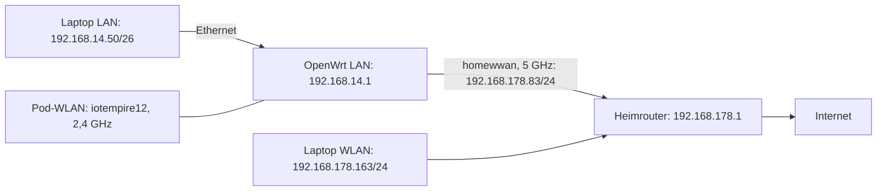

Vor Aufgabe 6 hatte das LAN die Maske `/24` und mein Laptop die Adresse
`192.168.14.139`. Danach war das LAN auf `/26` begrenzt und der Laptop
per DHCP auf `.50` reserviert. Die Router- und Brokeradresse blieb gleich.

## Routerstand

| Einstellung | Geprüfter Stand |
| --- | --- |
| Modell | Cudy TR1200 v1 |
| OpenWrt | 25.12.6, Revision `r33311-981c978eff` |
| Kernel | 6.12.112 |
| LAN | `192.168.14.1/26` auf `br-lan` |
| Pod-WLAN | `iotempire12`, 2,4 GHz, Kanal 1, WPA2/WPA3 |
| Heim-Uplink | `homewwan` auf `phy1-sta1`, `192.168.178.83/24` |
| Vorgeschaltetes Gateway | `192.168.178.1` |
| Extroot | `/dev/sda1`, ext4, als `/overlay` eingebunden, rund 7,2 GiB |
| Verwaltung | LuCI auf Port 80, SSH auf Port 22 mit vorhandenem Schlüssel |
| MQTT | Mosquitto läuft auf TCP-Port 1883 |
| DHCP-Pool nach Aufgabe 6 | `.10` bis `.49` |
| Reservierter Laptop | `192.168.14.50`, MAC `80:3f:5d:fb:9b:4d` |
| Portweiterleitung nach dem Test | Entfernt; neue Verbindungen zu Port 11883 blockiert |

Die Befehlsausgaben stehen im
[Ausgangsprotokoll](evidence/router-baseline-2026-11-14.json)
und im [Abschlusstest](evidence/home-handoff-2026-11-14.json).

## Aufgabe 1 – OpenWrt flashen

Wir haben den Router in der Vorlesung mit OpenWrt eingerichtet.
Für den TR1200 v1 beschreibt die Gerätedokumentation zwei Schritte:
zuerst das von Cudy akzeptierte Übergangsimage und danach ein passendes
OpenWrt-Sysupgrade-Image. Über Ethernet bleibt der Zugriff auch dann
möglich, wenn sich die WLAN-Einstellungen beim Flashen ändern.

Auf dem Laptop liegen `openwrt-tr1200-transition-firmware.bin` und
`openwrt-25.12.6-cudy_tr1200-v1-squashfs-sysupgrade-custom.bin`.
Die SHA-256 der vorhandenen Dateien wurde am 14.11.2026 nachträglich
bestimmt. Für das Custom-Sysupgrade-Image lautet sie:

```text
210ae96f049fd63094afff331ee3a6a32910e0bbb39a8e3523c53beecc102bdd
```

Das ist der Hash unserer vorhandenen Datei, kein Abgleich mit einem
unveränderten Standardimage. Beide Dateihashes stehen im
[Prüfsummenprotokoll](evidence/firmware-files-sha256-2026-11-14.json).
Für die Dokumentation wurde der Router nicht erneut geflasht.

### Stolperstelle: Versionsnummer nicht gefunden

Nach dem Flashen haben wir die Versionsnummer zunächst nicht gefunden und
konnten deshalb nicht sicher weiterarbeiten. Erst nach Absprache mit
unserem Professor konnten wir weitermachen. In LuCI steht die Version
unter **Status → Overview → Firmware Version**. Bei der jetzigen Prüfung
zeigt der Router dort OpenWrt 25.12.6 an.

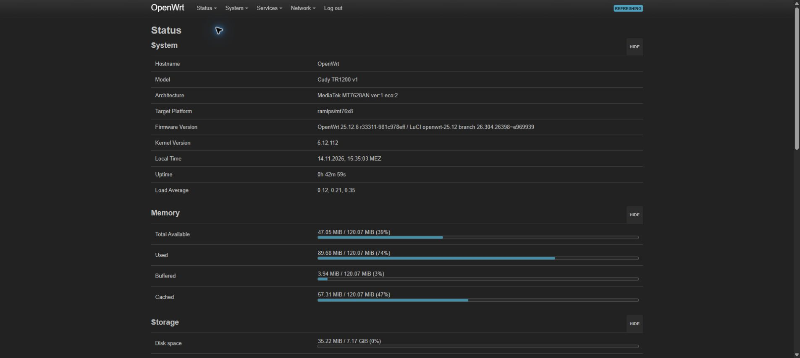

## Aufgabe 2 – Speicher mit Extroot erweitern

Der interne Flash ist mit 16 MiB knapp. Mit Extroot liegt der beschreibbare
Overlay-Speicher auf dem USB-Stick, während das Grundsystem im internen
Flash bleibt. Unter **System → Mount Points** ist `/dev/sda1` als
`/overlay` eingebunden. `df -h /overlay` zeigt rund 7,2 GiB statt der wenigen
MiB des internen beschreibbaren Speichers.

Der Stick muss deshalb beim Start am Router bleiben. Ohne ihn fehlt der
externe Overlay-Stand mit den dort installierten Paketen und Einstellungen.

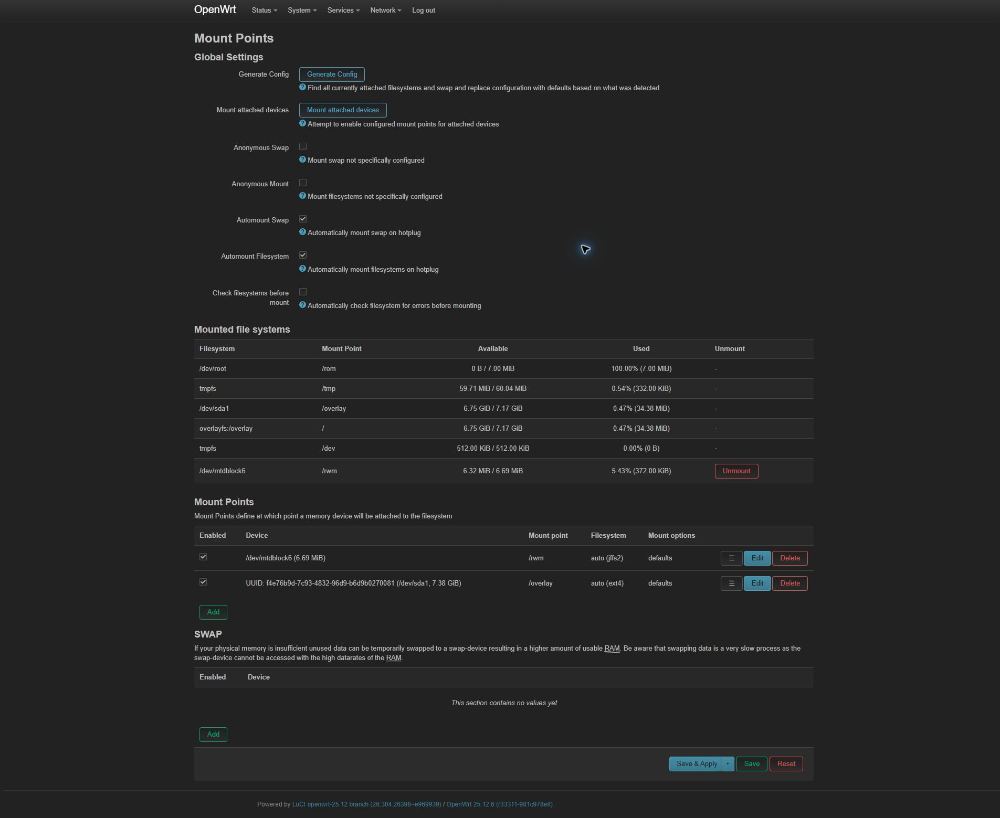

## Aufgabe 3 – Uplink und Routing

Auf dem Router war eduroam als 5-GHz-Client konfiguriert. Zu Hause war dieses
Netz nicht erreichbar. Wir haben deshalb für das Heim-WLAN die zusätzliche
Schnittstelle `homewwan` eingerichtet. Die eduroam-Konfiguration blieb
vorhanden. Das WLAN-Kennwort wurde direkt in LuCI eingegeben.

Der Router bekam im Heimnetz per DHCP `192.168.178.83/24`. Die Standardroute
führt über `192.168.178.1`; `ip route get 1.1.1.1` wählt dafür `phy1-sta1`.
Ein Ziel im Pod-LAN bleibt dagegen auf `br-lan`.

```text
default via 192.168.178.1 dev phy1-sta1 src 192.168.178.83
192.168.14.0/26 dev br-lan src 192.168.14.1
192.168.178.0/24 dev phy1-sta1 src 192.168.178.83
```

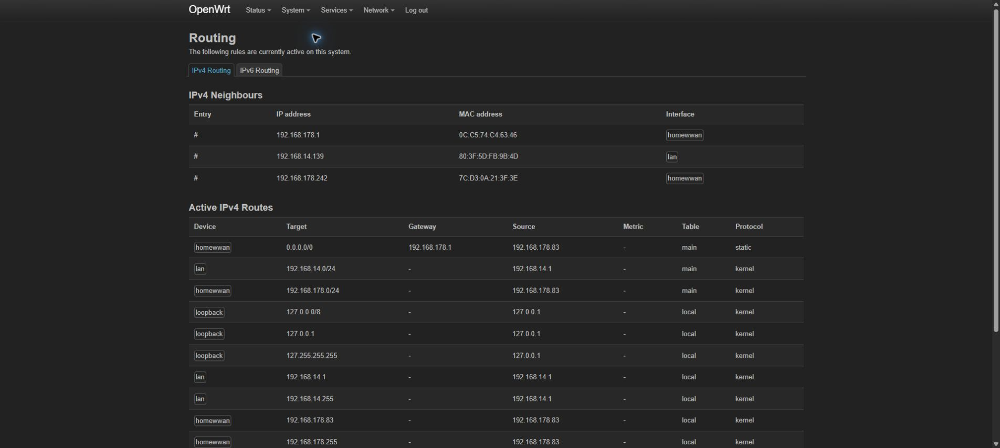

## Aufgabe 4 – Pod-LAN und MQTT-Broker

Das Pod-LAN war zunächst als `192.168.14.0/24` eingerichtet.
`dnsmasq` vergab die Adressen per DHCP; der ursprüngliche Pool startete
bei `.100` und umfasste 150 Adressen, also `.100–.249`. Mein Laptop bekam
zunächst `.139` und verwendete `192.168.14.1` als Gateway und DNS-Server.

In der Firewall ist die Weiterleitung von LAN nach WAN erlaubt.
Die WAN-Zone verwendet Masquerading; neue eingehende Verbindungen werden
standardmäßig nicht einfach zu den LAN-Diensten durchgelassen.

Mosquitto läuft auf `192.168.14.1:1883` und ist für den Autostart aktiviert.
Für den jetzigen Test haben wir zwei getrennte MQTT-Clients auf meinem
Laptop verwendet: einen Publisher und einen Subscriber. Es waren zwei
Client-Verbindungen, kein Test mit zwei verschiedenen Laptops.

| Test | Ergebnis |
| --- | --- |
| Topic | `pod12/portfolio/lan` |
| Gesendete Nachricht | `module02-lan-151609` |
| Empfangene Nachricht | `module02-lan-151609` |
| QoS / Retain | 0 / aus |

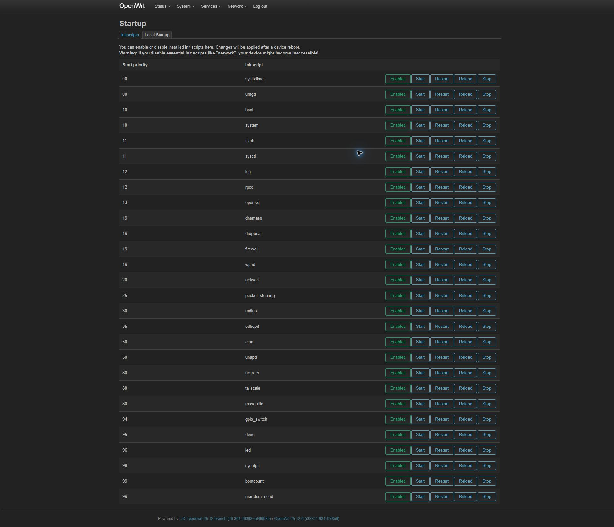

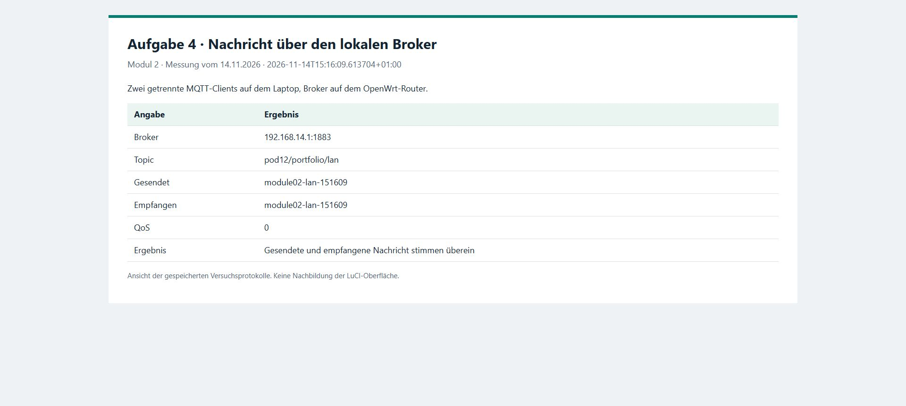

Der Broker erlaubt im Labortest anonyme Verbindungen ohne TLS.
Das ist keine Einstellung für einen öffentlich erreichbaren Broker.
Das [MQTT-Testprotokoll](evidence/mqtt-lan-2026-11-14.json) hält den Empfang fest.

## Aufgabe 5 – ARP, DHCP, DNS und MQTT mitschneiden

Für den Mitschnitt haben wir `tcpdump` installiert. OpenWrt 25.12 verwendet
dafür `apk`. Aufgenommen wurde auf der LAN-Bridge `br-lan`:

```sh
apk update
apk add tcpdump
tcpdump -U -i br-lan -s 0 -w /tmp/portfolio-lan.pcap \
  'arp or udp port 67 or udp port 68 or udp port 53 or tcp port 1883'
```

Während der Aufnahme haben wir die LAN-DHCP-Adresse freigegeben und neu
angefordert, `openwrt.org` über den Router aufgelöst und eine MQTT-Nachricht
veröffentlicht. Der Mitschnitt entstand noch vor der Verkleinerung des
Subnetzes, deshalb taucht hier die Laptop-Adresse `.139/24` auf.

| Protokoll | Beobachtung | Was sich daraus ablesen lässt |
| --- | --- | --- |
| DHCP | Discover, Offer, Request und ACK mit Transaktionskennung `0x202f3825` | Der Router bietet `.139` an und bestätigt `/24` und Gateway `.1` |
| ARP | Anfrage nach `192.168.14.1`, Antwort mit `d4:0d:ab:52:c1:a0` | Der Laptop erfährt die MAC-Adresse seines Gateways |
| DNS | Anfrage für `openwrt.org` und passende Antwort | Die Namensauflösung über den Router funktioniert |
| MQTT | PUBLISH an den Broker und Weitergabe an den Subscriber | Die Testnachricht wird tatsächlich übertragen |

Im DHCP-Discover sendet der Client von UDP-Port 68 an Port 67.
Die Antwort kommt von Port 67 an 68. Offer und ACK enthielten die Maske
`255.255.255.0` und das Gateway `192.168.14.1`.
Die MQTT-PUBLISH-Nachrichten trugen das Topic `pod12/portfolio/capture`
und die Nachricht `module02-capture-151634`.

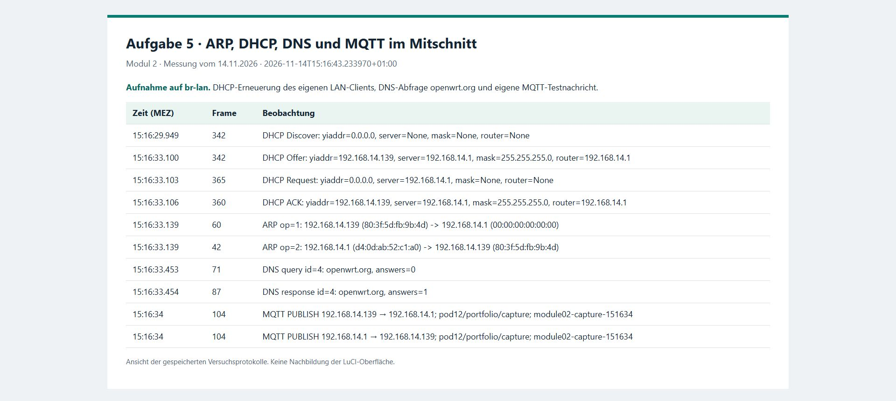

Der [gefilterte Paketmitschnitt](evidence/lan-protocols-2026-11-14.pcap)
enthält 47 Frames aus unserem Versuch. Die
[Textauswertung](evidence/lan-protocols-2026-11-14.json) ordnet die Pakete zu.
Unbeteiligte Netzwerkadapter und fremde DNS-Abfragen sind nicht Teil der
veröffentlichten Auszüge.

## Aufgabe 6 – Subnetz verkleinern und einen Client reservieren

Wir haben zuerst die möglichen Netze berechnet. Die Zahl der Adressen ergibt
sich aus den Hostbits; Netz- und Broadcast-Adresse fallen als Geräteadressen weg.

| Präfix | Maske | Netzadresse | Broadcast | Nutzbare Hosts |
| --- | --- | --- | --- | --- |
| /24 | 255.255.255.0 | 192.168.14.0 | 192.168.14.255 | .1–.254, `2^8 − 2 = 254` |
| /26 | 255.255.255.192 | 192.168.14.0 | 192.168.14.63 | .1–.62, `2^6 − 2 = 62` |
| /28 | 255.255.255.240 | 192.168.14.0 | 192.168.14.15 | .1–.14, `2^4 − 2 = 14` |

Wir haben `/26` beibehalten. Der Router bleibt auf `.1`; der dynamische
DHCP-Pool reicht jetzt von `.10` bis `.49`. Für meinen LAN-Adapter ist
`.50` als feste DHCP-Zuordnung hinterlegt. Die Adresse liegt innerhalb
des `/26`-Netzes, aber außerhalb des dynamischen Pools.

```sh
uci set network.lan.ipaddr='192.168.14.1/26'
uci set dhcp.lan.start='10'
uci set dhcp.lan.limit='40'
uci set dhcp.portfolio_laptop='host'
uci set dhcp.portfolio_laptop.name='LaptopFabius'
uci set dhcp.portfolio_laptop.mac='80:3f:5d:fb:9b:4d'
uci set dhcp.portfolio_laptop.ip='192.168.14.50'
uci commit network
uci commit dhcp
/etc/init.d/network reload
/etc/init.d/dnsmasq restart
```

Nach dem Übernehmen und Erneuern der DHCP-Adresse zeigte Windows
`192.168.14.50` mit Präfixlänge 26 an. MQTT funktionierte auch danach.
Eine DHCP-Reservierung ist keine manuell am Laptop eingetragene feste IP:
Der Laptop fragt weiter beim DHCP-Server an und erhält dort dieselbe Adresse.

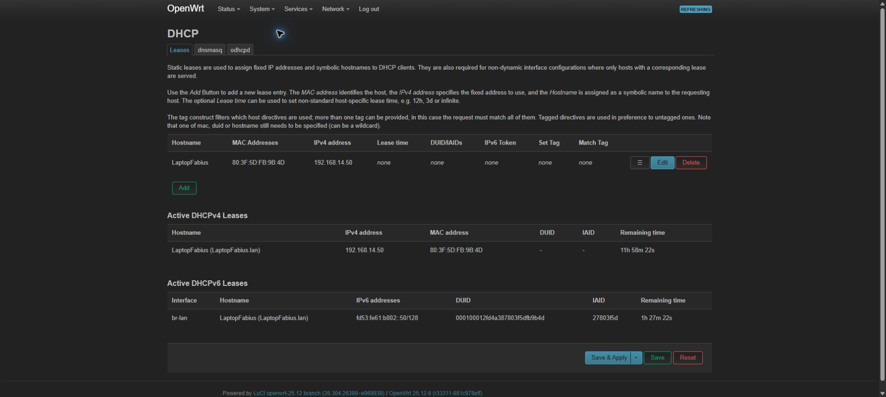

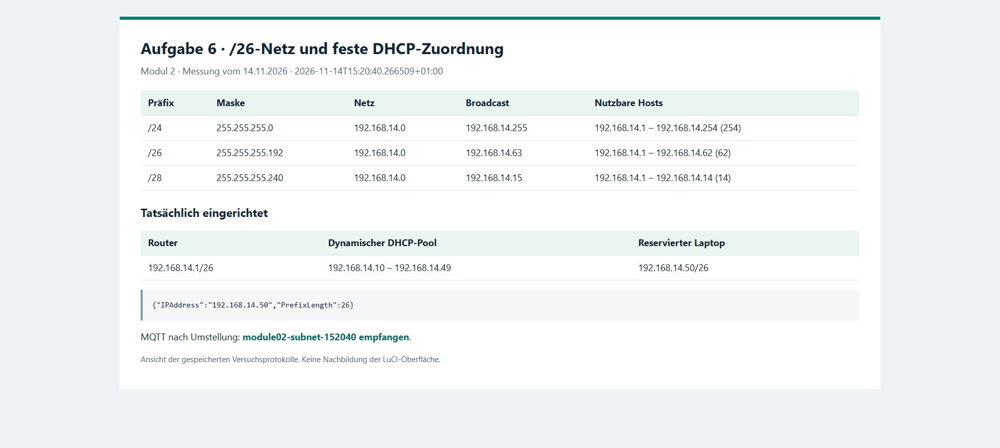

Das [Vorher-/Nachher-Protokoll](evidence/subnet-reservation-2026-11-14.json)
enthält die Router- und Clientwerte.

## Aufgabe 7 – Portweiterleitung und NAT

Als Außennetz haben wir zu Hause das Heim-WLAN statt des Kurs-WLANs
verwendet. Mein Laptop blieb per Ethernet im Pod-LAN; seine WLAN-Schnittstelle
war gleichzeitig mit `192.168.178.163` im Heimnetz. Der Subscriber wurde
an diese WLAN-Adresse gebunden, der Publisher verwendete den LAN-Weg.

Die Testregel leitete TCP-Port `11883` auf der WAN-Adresse
`192.168.178.83` an `192.168.14.1:1883` weiter. Sie galt nur für die
Quelladresse `192.168.178.163`.

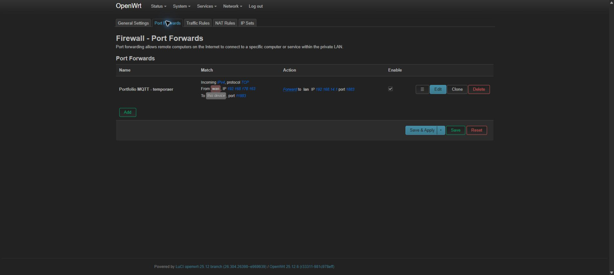

| Schritt | Ergebnis |
| --- | --- |
| Vor dem Einrichten | Neue Verbindung zu `192.168.178.83:11883` lief in den Timeout |
| Mit Testregel | Der WAN-Subscriber empfing `module02-nat-152505` vom LAN-Publisher |
| Nach dem Entfernen | Neue Verbindung zu Port 11883 lief wieder in den Timeout |

Der Mitschnitt lief hier auf `any`, mit dem Filter
`tcp port 1883 or tcp port 11883`. Weil der Broker auf dem Router selbst
läuft, zeigt die Verbindungstabelle die Zielübersetzung besonders klar:

```text
Original: 192.168.178.163:59445 → 192.168.178.83:11883
Antwort:  192.168.14.1:1883    → 192.168.178.163:59445
```

Im Mitschnitt sieht man außerdem die separate Veröffentlichung vom
LAN-Client an den Broker. Das sind zwei MQTT-Verbindungen, nicht zwei
Ansichten desselben weitergeleiteten LAN-Pakets. Auf `any` können Pakete
an mehreren Schnittstellen erscheinen und deshalb mehrfach auftauchen.

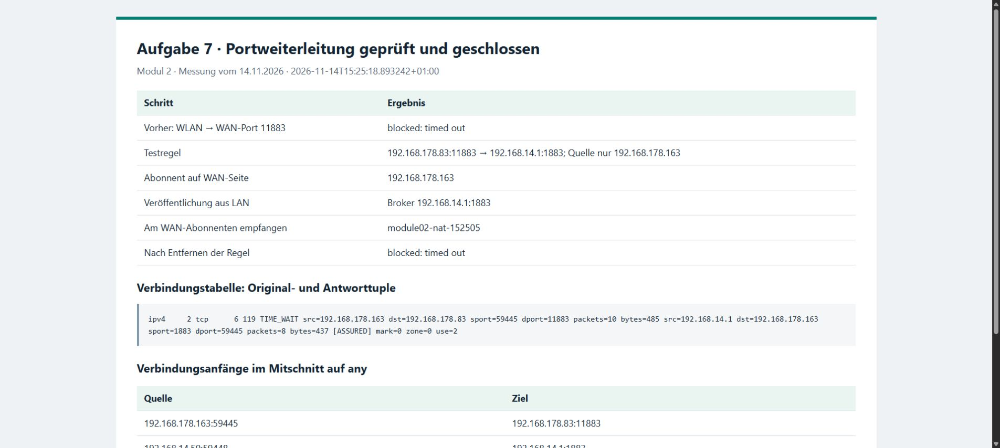

Nach dem Test haben wir die Regel gelöscht. Der anonyme Broker bleibt
über diesen WAN-Port nicht erreichbar. Im eduroam-Netz wäre dieser Test
wegen möglicher Client-Isolation schwerer eindeutig auszuwerten gewesen.

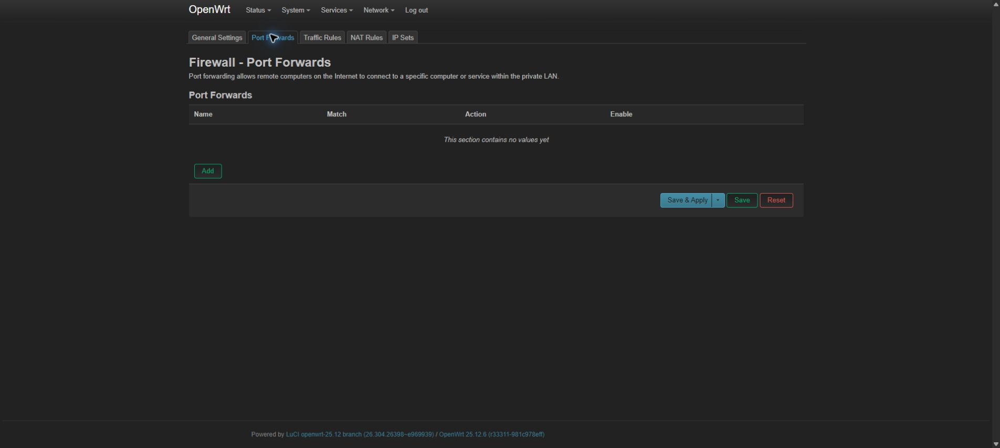

Dazu gehören der [NAT-Mitschnitt](evidence/nat-test-2026-11-14.pcap),
der [erfolgreiche Empfang](evidence/nat-open-test-2026-11-14.json)
und der [Abschlusstest ohne Freigabe](evidence/nat-closed-test-2026-11-14.json).
Masquerading ersetzt bei ausgehenden Verbindungen die LAN-Quelladresse.
Die getestete Portweiterleitung ändert dagegen das Verbindungsziel;
die Firewall muss diesen eingehenden Zugriff zusätzlich zulassen.

Für das ausgehende Masquerading haben wir außerdem einen Ping mit der
LAN-Quelladresse `192.168.14.50` an `1.1.1.1` gesendet. Beide Antworten
kamen an. In Conntrack steht im Original die Quelladresse `.14.50`, im
Antwortweg dagegen die Zieladresse `192.168.178.83`. Das
[Ping- und NAT-Protokoll](evidence/lan-internet-nat-2026-11-14.json)
zeigt damit auch die Übersetzung einer ausgehenden LAN-Verbindung.

## Aufgabe 8 – Router zu Hause weiterverwenden

Der neue Uplink läuft auf 5 GHz über das Heim-WLAN. Die zusätzliche
Schnittstelle heißt `homewwan`; eduroam musste dafür nicht gelöscht werden.
Das Heimnetz `192.168.178.0/24` überschneidet sich nicht mit unserem
Pod-Netz `192.168.14.0/26`.

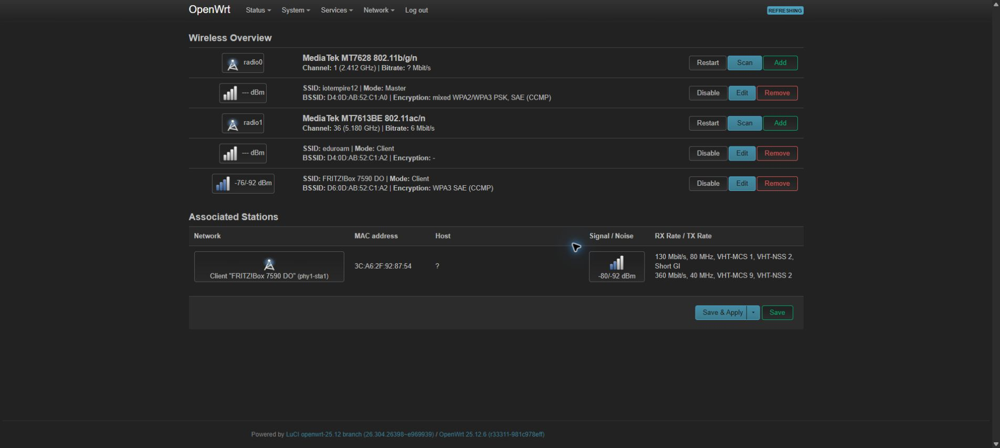

Beim Uplinkwechsel änderten sich WAN-Adresse und vorgeschaltetes Gateway.
Die LAN- und Brokeradresse blieb `192.168.14.1`; nur die LAN-Maske hatten
wir in Aufgabe 6 bewusst auf `/26` geändert.

Im Abschlusstest antwortete `1.1.1.1` zweimal, ohne Paketverlust, mit
13,828 und 14,839 ms RTT. DNS für `openwrt.org` funktionierte ebenfalls.
Die Nachricht `module02-handoff-153011` kam am MQTT-Subscriber an.
Extroot war weiterhin eingebunden und die Routeruhr zeigte das aktuelle Datum.

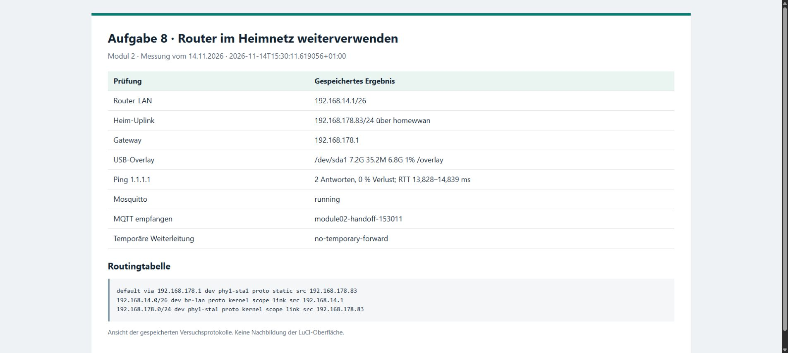

Router und USB-Stick bleiben für die weitere Arbeit zusammen.
WLAN-Zugangsdaten sind nicht Bestandteil dieser Dokumentation.
Bei einer Übergabe müssen persönliche Zugangsdaten vorher entfernt werden.

## Aufgabe 9 – Warum OpenWrt?

OpenWrt entstand 2004 aus den veröffentlichten GPL-Quellen für den
Linksys WRT54G. Der LEDE-Fork von 2016 wurde 2018 wieder mit OpenWrt
zusammengeführt. Die [Projektgeschichte](https://openwrt.org/about/history)
zeigt den Weg von der Herstellerbasis zur eigenen Routerdistribution.

Unser Beispiel ist der Cudy TR1200 v1. Die
[Geräteseite](https://openwrt.org/toh/cudy/tr1200#oem_easy_installation)
beschreibt das signierte Übergangsimage und den anschließenden
Sysupgrade-Schritt. Sie nennt Unterstützung ab 23.05.4; auf unserem
Router läuft 25.12.6. Als konkrete Einschränkung nennt die Seite fehlende
DFS-Unterstützung des 5-GHz-Chips. Modell und Hardwareversion müssen
deshalb zur jeweiligen Anleitung passen.

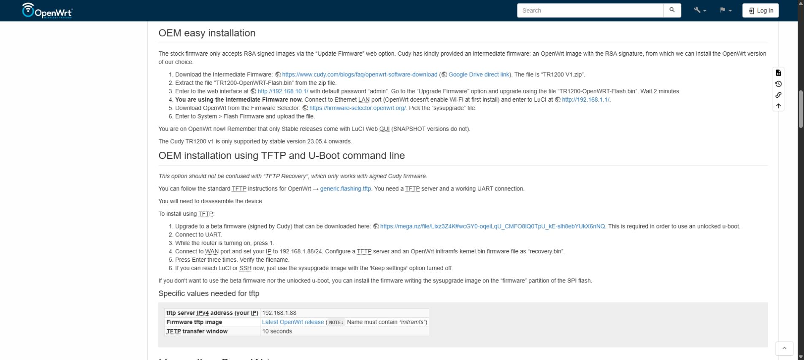

Für unseren Laborrouter ist OpenWrt sinnvoll, weil wir Pakete nachinstallieren,
mit UCI konfigurieren und per `tcpdump` nachvollziehen können, was im Netz
passiert. Bei einem Router für den täglichen Betrieb würde ich vorher
Geräteunterstützung, Wiederherstellung und Wartungsaufwand prüfen.
Die zusätzliche Kontrolle bedeutet auch, Updates und Fehlersuche selbst
zu übernehmen, statt sich auf den Herstellersupport zu verlassen.

Extroot, zusätzliche Pakete und die geskripteten DHCP- und Firewallregeln
wären in einer geschlossenen Herstelleroberfläche deutlich schwerer
umzusetzen. Herstellerfunktionen sind dafür oft bereits aufeinander
abgestimmt und leichter einzurichten. Eine FRITZ!Box mit FRITZ!OS ist
außerdem nicht einfach OpenWrt; ein unterstützter OpenWrt-Port wäre ein
anderes Betriebssystem auf dem Gerät.

## Gesprächsnotizen

Nach dem Flashen haben wir mit dem Professor geklärt, wie wir den
Firmwarestand feststellen und weiterarbeiten können. Die übrigen Aufgaben
haben Jonas und ich gemeinsam in der Vorlesung beziehungsweise zu Hause
bearbeitet. Weitere Gespräche mit anderen Pods sind hier nicht festgehalten.

## Begriffe aus dem Modul

Ein Haken steht für einen Begriff, den ich hier am Aufbau oder im Mitschnitt
zuordnen kann. Die übrigen Begriffe bleiben als Überblick für die nächsten Module.

| Begriff | Bedeutung | Wo er vorkommt | ✓ | Beleg |
| --- | --- | --- | --- | --- |
| Übertragungsmedien | Kupferkabel, Glasfaser oder Funk | Ethernet zum Router, WLAN-Uplink | ✓ | Netzwerkplan und Uplink |
| Leitungscodes / Modulation | Bits als Signale, etwa Manchester oder OFDM | Funkaufgaben in Modul 5 | | Nicht untersucht |
| Seriell / parallel | Bits nacheinander oder über mehrere Leitungen gleichzeitig | UART/RS-485 in Modul 6 | | Nicht untersucht |
| Synchron / asynchron | Gemeinsamer Takt oder eigene Zeichensynchronisation | UART und Funkprotokolle | | Nicht untersucht |
| Simplex / Halbduplex / Vollduplex | Eine Richtung, wechselnde Richtung oder beide gleichzeitig | Ethernet und WLAN | | Duplexverhalten nicht gemessen |
| Topologie | Bus, Stern, Ring oder Mesh | Router und MQTT-Broker als zentrale Knoten | ✓ | Netzwerkplan und MQTT-Test |
| MAC-Adressen / ARP | Layer-2-Adresse und Zuordnung von IP zu MAC | Anfrage nach der Gateway-MAC | ✓ | LAN-Mitschnitt |
| Kollisions- / Broadcast-Domäne | Bereich möglicher Kollisionen beziehungsweise erreichter Broadcasts | LAN-Bridge und Routergrenze | | Broadcast gesehen, Kollisionen nicht untersucht |
| Fehlererkennung | Erkennung beschädigter Daten, etwa CRC/FCS | Ethernet und spätere Feldbusse | | Keine Fehleranalyse durchgeführt |
| CSMA/CD / CSMA/CA | Kollisionserkennung beziehungsweise Kollisionsvermeidung | Ethernet-Grundlagen und WLAN | | Nicht untersucht |
| Routing / Standardgateway | Auswahl des nächsten Wegs anhand der Routingtabelle | Standardroute über den Heimrouter | ✓ | Routingtabelle |
| Klassen / CIDR | Historische Adressklassen gegenüber Präfixlängen | /24, /26 und /28 | ✓ | Subnetztabelle und Clientpräfix |
| Broadcast / Fragmentierung | Zustellung an alle im Netz beziehungsweise Aufteilung von Paketen | DHCP-Discover als Broadcast | | Broadcast belegt, keine Fragmentierung untersucht |
| TCP / UDP und Flusskontrolle | Bytestrom gegenüber Datagrammen; Begrenzung des Datenflusses | MQTT über TCP, DNS und DHCP über UDP | | Protokolle gesehen, Flusskontrolle nicht ausgewertet |
| Sitzung / Darstellung / Anwendung | Sitzungsaufbau, Datenformat und Anwendungsprotokoll | MQTT-Verbindung und Testnachricht | ✓ | MQTT-Test und PUBLISH-Pakete |
| Spanning Tree Protocol | Vermeidet Schleifen in gebrückten Layer-2-Netzen | Spätere Netzaufbauten | | Nicht untersucht |

## Bezug zu den Lernzielen

| Lernziel | Ergebnisse |
| --- | --- |
| LG1 – Adressierung und Routing | Netzwerkplan, Heim-Uplink, /26-Berechnung und feste DHCP-Zuordnung |
| LG2 – ARP, DHCP, DNS und NAT | Protokollmitschnitt, MQTT-Empfang und kontrollierter Weiterleitungstest |
| LG3 – OpenWrt verwalten | Firmwarestand, LuCI/SSH, Extroot, Uplink, Broker und Konfiguration |
| LG4 – Paketmitschnitt | Aufnahme auf br-lan und any, gefilterter LAN-Mitschnitt und Paketzuordnung |

## Reflexion

Meine Erfahrungen aus diesem Modul stehen zusammen mit den Grundlagen
in [Reflexion 1](../Reflections/ref01.md).
