# Modul 3 – Overlay-Netz mit Nebula und MQTT über das Overlay

**20.11.2026 · Aufgaben 1, 2, 4 und 5 · Remote proof von zu Hause am 21.11.2026**

Dieses Modul habe ich zusammen mit
[Jonas Prijic](https://github.com/OffBeatAtze/net-iot-hsbi-2026-portfolio)
bearbeitet. Wir haben unseren Pod-Router mit einem Nebula-Bundle ins
Overlay-Netz der Klasse gebracht, eine MQTT-Nachricht über das Overlay zu
Node-RED auf dem Klassen-Cluster und zurück geschickt, das Netz gezeichnet
und die Verbindung gemessen. Die optionalen Aufgaben 3 (eigenes Zertifikat
für den Laptop) und 6 (MicroPython auf dem Router) haben wir nicht bearbeitet.

## Lernziele

Aus dem [Kursblatt](../materialien/hsbi-networking-iot-10d/modules/03-overlay-and-mesh-networks.md#-learning-goals).

<a id="lg1"></a>
### LG1 – Overlay

Explain what an overlay network is and when it beats a port forward: changing WAN
addresses, campus firewalls, CGNAT/DS-Lite, hole punching. *(The NAT variants are
optional depth; know the shape of the problem.)*

**Nachweise:** [Underlay, Overlay und Erklärung für Mara](#task-4),
[Latenz und Durchsatz](#task-5),
[Zugriff aus dem Heimnetz](#remote-proof).

Beim Test von zu Hause blieb die Overlay-Adresse des Routers nach dem Wechsel von
eduroam ins Heim-WLAN gleich. Über diese Verbindung konnte ich Node-RED erreichen,
ohne am Heimrouter einen Port zu öffnen.

<a id="lg2"></a>
### LG2 – Nebula

Deploy a Nebula node from a bundle on the router, and explain what the CA, the
certificate, the key, and the config each do.

**Nachweise:** [Router ins Overlay bringen und Bundle erklären](#task-1).

Beim Einrichten von `nebula1` habe ich nachvollzogen, dass die CA das
Router-Zertifikat signiert und der passende private Schlüssel auf dem Router
geschützt liegen muss.

<a id="lg3"></a>
### LG3 – Architektur

Draw a network architecture involving an overlay network and explain the network
and the roles in the mesh (nodes, certificate, peer, lighthouse).

**Nachweise:** [Netze zeichnen und Schichten benennen](#task-4).

Beim Zeichnen der beiden Netzebenen habe ich die öffentlichen Adressen von den
Overlay-Adressen getrennt. Das Router-Log zeigte mir, wann Pakete über das Relay
liefen und wann sich die Peers direkt erreichten.

<a id="lg4"></a>
### LG4 – MQTT

Make the router the pod's gateway into the overlay, reach your Node-RED instance
on the Optiplex cluster through the overlay, and move one MQTT message each way.

**Nachweise:** [MQTT-Rundlauf im Node-RED-Debug](#task-2),
[Node-RED aus dem Heimnetz erreichen](#remote-proof).

Im Node-RED-Debug habe ich am zurückgekommenen `on` den Rundlauf über den Broker
auf unserem Router nachvollzogen. Der Empfang in einem separaten MQTT-Client
bleibt offen.

## Overlay plan

| Rolle | Name | Overlay-Adresse | Underlay |
| --- | --- | --- | --- |
| Pod-Router, Broker, Gateway ins Overlay | `router12.hsbi-netiot.ulno.mesh` | `10.100.0.22/16` auf `nebula1` | LAN `192.168.14.1/26`, Uplink eduroam `10.132.204.197/19` |
| Lighthouse und Relay | `vps.ulno.mesh` (`vps.ulno.net`) | `10.100.0.1` | öffentlich `217.160.138.8`, UDP `4545` |
| Node-RED | `ulno-oldplex04.hsbi01.ulno.mesh` | `10.100.1.13` | Cluster hinter NAT, öffentlich `212.201.138.168` |
| Messhost für Aufgabe 5 | `ulno-oldplex01.hsbi01.ulno.mesh` | `10.100.1.1` | wie oldplex04 |
| Laptop | – | erscheint im Mesh als `10.100.0.22` | `192.168.14.29` im Pod-LAN |

Node-RED erreichen wir unter `http://ulno-oldplex04.hsbi01.ulno.mesh:18083`.
Die Zeichnungen und die [Antwort an Mara](#antwort-an-mara) stehen unten.
Der [MQTT-Pfad](#pfadskizze) zeigt, wie Nachrichten zwischen dem
Pod-Broker und Node-RED laufen.

<a id="task-4"></a>
### Aufgabe 4 – Netze zeichnen und Schichten benennen

**Lernziele:** [LG1](#lg1), [LG3](#lg3)

Alle drei Bilder stammen aus einer draw.io-Datei:
[netzplan-underlay-overlay.drawio](diagrams/netzplan-underlay-overlay.drawio).
Adressen, Gruppen und den Tunnelweg habe ich am 20.11.2026 vom Router
ausgelesen, die Werte für „Zuhause“ beim Remote proof am 21.11.2026. Der
gestrichelte Bereich „Mobil“ ist nur ein Beispiel; dort haben wir nicht
gemessen.

#### Underlay

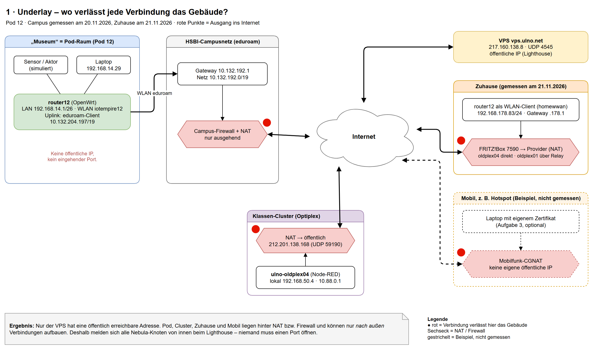

Unser Router hängt als WLAN-Client im eduroam und geht über die
Campus-Firewall mit NAT ins Internet. Der Cluster liegt ebenfalls hinter
NAT und erscheint außen als `212.201.138.168`. Nur der VPS mit dem
Lighthouse hat eine öffentlich erreichbare Adresse.

#### Overlay

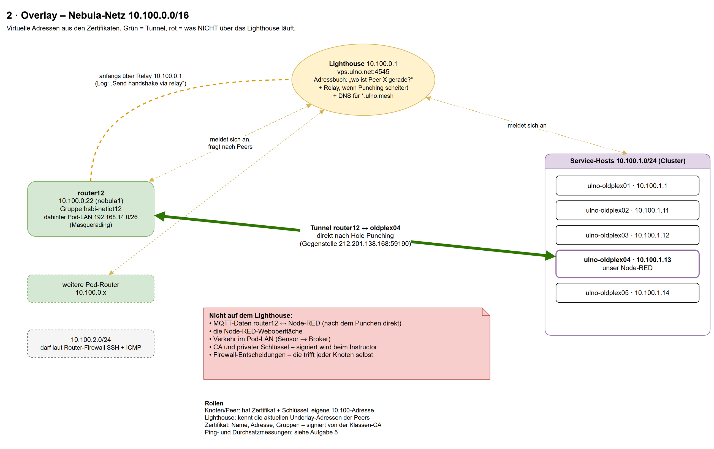

Im Router-Log sieht man, wie der Tunnel zu oldplex04 entstanden ist.
Zuerst lief der Handshake über das Relay auf `10.100.0.1`
(„Send handshake via relay“). Kurz danach meldet Nebula „Host roamed to new
udp ip/port“ mit `212.201.138.168:59190`. Ab da gingen die Pakete direkt
zum Cluster. Auch der Handshake mit dem Messhost `10.100.1.1` kam direkt
von `212.201.138.168`.

#### Gesamtbild mit Schichten

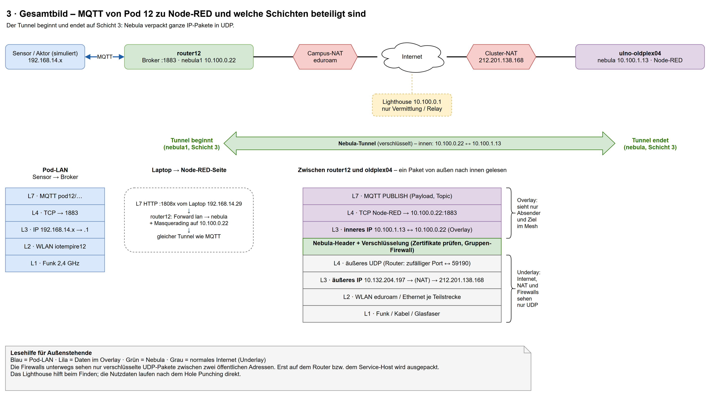

Der Tunnel beginnt an `nebula1` auf dem Router und endet am
Nebula-Interface von oldplex04, beide auf Schicht 3. Innen läuft MQTT über
TCP und das innere IP mit den Overlay-Adressen. Außen sieht das Netz nur
UDP zwischen öffentlichen Adressen.

#### In drei Sätzen

Ein Overlay ist ein virtuelles Netz über dem normalen Internet: Jeder
Knoten hat eine feste Adresse aus seinem Zertifikat und erreicht die
anderen über verschlüsselte UDP-Tunnel, egal hinter welchem NAT er gerade
steht. Das Lighthouse ist nur das Adressbuch: Es sagt den Knoten, unter
welcher öffentlichen Adresse ein Peer gerade zu finden ist, und leitet nur
dann selbst weiter, wenn sich zwei Knoten nicht direkt erreichen, zum
Beispiel hinter demselben NAT oder bei CGNAT. Vorbereitet hat unser
Professor die CA, das Lighthouse mit öffentlicher IP und ein Bundle pro
Knoten. Für einen weiteren Standort würde er ein neues Zertifikat mit
passender Gruppe signieren, und dort würde man Bundle, Interface und
Firewall-Zone einrichten wie bei uns.

#### Antwort an Mara

Liebe Frau Voss,
die Skulptur und das Dashboard sind jetzt über ein privates Netz verbunden,
das über das normale Internet läuft. Dafür muss niemand ein Loch in eine
Firewall bohren: Der Router im Museum baut die Verbindung selbst nach
draußen auf, so wie ein Laptop, der eine Webseite öffnet. Sie erreichen die
Skulptur unter einer festen Adresse und können Animationen aktualisieren
und Sensordaten lesen, ohne hinzufahren. Wer hinein darf, legt ein eigenes
Zertifikat fest. Geht eines verloren, wird nur dieses eine gesperrt. Am
Museumsnetz selbst hat sich nichts geändert, die IT dort musste nichts
einstellen. Eine Grenze gibt es: Auf beiden Seiten muss die Nebula-Software
laufen. Und wenn keine direkte Verbindung zustande kommt, läuft der Verkehr
über den Vermittlungsserver und ist spürbar langsamer als im selben WLAN.

#### Andere Overlay-Lösungen

Tailscale und NetBird bringen einen zentralen Koordinationsserver mit:
Anmeldung über SSO, Zugriffsregeln in einer Weboberfläche und einen
automatischen Relay als Rückfallebene. Bei Nebula pflegt man Zertifikate,
Gruppen und Firewall-Regeln dagegen pro Knoten. Das
[nebula-manager](https://github.com/iotempire/nebula-manager)-Werkzeug der
Klasse übernimmt das mit Menü und CLI und verteilt die Bundles zum Beispiel
per `croc`. Headscale ersetzt bei Tailscale den Server des Herstellers durch
einen selbst betriebenen. Der Kurs nutzt eine eigene CA, weil dafür kein
Fremdanbieter und kein Benutzerkonto nötig ist und man sieht, wer welches
Zertifikat bekommt und welche Gruppe welche Regel öffnet.

## Study log

**Was wir wirklich gebraucht haben:** das Bundle, das Paket
`luci-proto-nebula`, ein Interface mit dem richtigen Namen, eine
Firewall-Zone mit Covered Device und Masquerading und die DNS-Weiterleitung
für `ulno.mesh`. Einen Port am Campus oder an der FRITZ!Box mussten wir
nicht öffnen.

**Was uns überrascht hat:**

- LuCI zeigt bei `nebula1` „Carrier: Absent“ und 0 Byte, obwohl das
  Interface funktioniert. Den echten Zustand sieht man mit
  `ip -brief addr show nebula1`.
- Der Tunnel zum selben Ziel kann erst über das Relay laufen und dann
  direkt. Von zu Hause lief oldplex04 direkt und oldplex01 über das Relay,
  mit einem Unterschied von etwa 30 ms gegen mehrere Sekunden.
- Über das Overlay kamen nur etwa 2,5 Mbit/s an, im LAN etwa 60 Mbit/s.
  Der kleine Router-Prozessor verschlüsselt jedes Paket.

**Fragen aus dem Kursblatt, die wir mit Claude geklärt und an unserem Mesh
geprüft haben:**

| Frage aus dem Kursblatt | Abgleich mit unserem Mesh |
| --- | --- |
| Warum scheitert eine Portweiterleitung hinter CGNAT oder einer Campus-Firewall, und was macht ein Overlay anders? | Am Campus hat unser Router nur die private Adresse `10.132.204.197`. Eine Weiterleitung auf ihm wäre von außen also gar nicht erreichbar. Nebula baut die Verbindung von innen auf. Laut Log kam der Handshake von oldplex04 tatsächlich durch, ohne dass wir einen Port geöffnet haben. |
| Was machen Zertifikat, Schlüssel, CA und Config im Bundle? | Mit `config.yml` und den Dateien in `/etc/nebula/` abgeglichen, siehe Bundle-Tabelle in Aufgabe 1 |
| Node-RED kann abonnieren, aber nicht veröffentlichen: Welche Schichten prüft man in welcher Reihenfolge? | Bei uns ging beides. Die Prüfreihenfolge haben wir trotzdem nachvollzogen: Ping über das Overlay (Schicht 3), die Nebula-Freigabe für TCP `1883` aus `10.100.1.0/24` (Schicht 4), `netstat -ltn` mit Mosquitto auf `0.0.0.0:1883` und dann Topic und Payload in Node-RED (Schicht 7). |

## Bundle notes

<a id="task-1"></a>
### Aufgabe 1 – Router ins Overlay bringen

**Lernziele:** [LG2](#lg2)

#### Inhalt des Bundles

Das Bundle für unseren Pod haben wir mit Unterstützung unseres Professors
per `croc` bekommen. Es enthält vier Dateien:

| Datei | Aufgabe |
| --- | --- |
| `ca.crt` | Öffentliches Zertifikat der Klassen-CA. Damit prüft der Router, ob ein anderer Knoten von derselben CA signiert wurde. |
| `router12.hsbi-netiot.ulno.mesh.crt` | Unser Zertifikat: Name, Overlay-Adresse `10.100.0.22` und Gruppe `hsbi-netiot12`, signiert von der CA |
| `router12.hsbi-netiot.ulno.mesh.key` | Privater Schlüssel zum Zertifikat, also das eigentliche Zugangsgeheimnis |
| `config.yml` | Lighthouse `10.100.0.1` unter `vps.ulno.net:4545`, Relay, Hole Punching, Firewall-Regeln und `tun: dev: nebula1` |

Das eigentliche Zugangsgeheimnis ist die `.key`-Datei. Wer sie zusammen mit
dem Zertifikat hat, kann sich im Mesh als unser Router ausgeben. Geht sie
verloren, muss nur dieses eine Zertifikat gesperrt und neu signiert werden;
alle anderen Knoten behalten ihre Bundles. Schlüssel und Zertifikate liegen
nicht in diesem Repository.

#### Paket installieren

Für die LuCI-Oberfläche haben wir `luci-proto-nebula` installiert. Es zieht
`nebula` und `nebula-proto` mit, alle drei stehen danach unter
**System → Software** als installiert.

```sh
apk update && apk add luci-proto-nebula && reboot
```

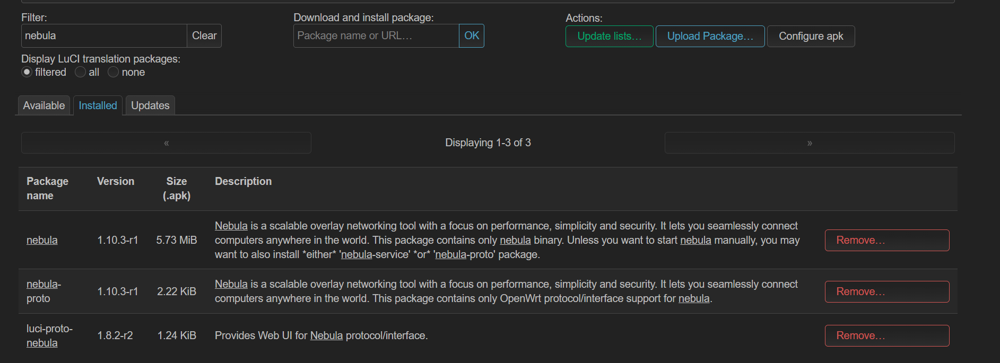

#### Stolperstelle: `pk update`

Beim ersten Versuch hat `apk update` nicht funktioniert. Ich hatte den
Befehl beim Kopieren nicht vollständig erwischt und nur `pk update`
eingefügt. Mit dem vollständigen Befehl lief die Installation durch.

#### Dateien kopieren und prüfen

Die vier Dateien haben wir nach `/etc/nebula/` kopiert. Das Kursblatt
nutzt dafür `scp -O`, weil OpenWrt keinen SFTP-Server hat. Danach haben wir
geprüft, ob alle Dateien angekommen sind, und den Schlüssel auf `600`
gesetzt. Vorher war er mit `-rw-r--r--` für alle lesbar. Die drei Pfade in
`config.yml` zeigen auf `/etc/nebula/`.

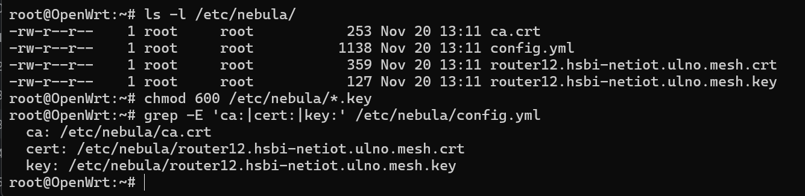

#### Interface `nebula1`

Unter **Network → Interfaces** haben wir ein Interface mit dem Protokoll
**Nebula Network** und der Konfiguration `/etc/nebula/config.yml` angelegt.

LuCI zeigt bei `nebula1` „Carrier: Absent“ und 0 Byte. Laut Kursblatt ist
das bei diesem Interface normal. Auf dem Router hat `nebula1` trotzdem seine
Adresse:

```text
nebula1          UNKNOWN        10.100.0.22/16
```

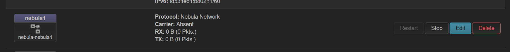

#### Stolperstelle: Interface-Name

Wir hatten das Interface zuerst `nebula12` genannt, weil das unsere
Pod-Nummer ist. Weil wir nicht sicher waren, ob das später Fehler macht,
haben wir es in `nebula1` umbenannt. Im Kursblatt steht dazu, dass Name und
`tun.dev` aus dem Bundle übereinstimmen müssen. In unserer `config.yml`
steht `dev: nebula1`. Mit `nebula12` wäre das Protokoll also vermutlich
gleich wieder abgebrochen.

#### Firewall

Die Zone `nebula` hat Input und Output `accept`, Intra-Zone-Forward
`reject` und IPv4-Masquerading. Das Gerät `nebula1` ist als Covered Device
eingetragen, und `lan` darf nach `nebula` weiterleiten.

```text
firewall.@zone[3].name='nebula'
firewall.@zone[3].input='ACCEPT'
firewall.@zone[3].output='ACCEPT'
firewall.@zone[3].forward='REJECT'
firewall.@zone[3].masq='1'
firewall.@zone[3].device='nebula1'
firewall.@forwarding[3].src='lan'
firewall.@forwarding[3].dest='nebula'
```

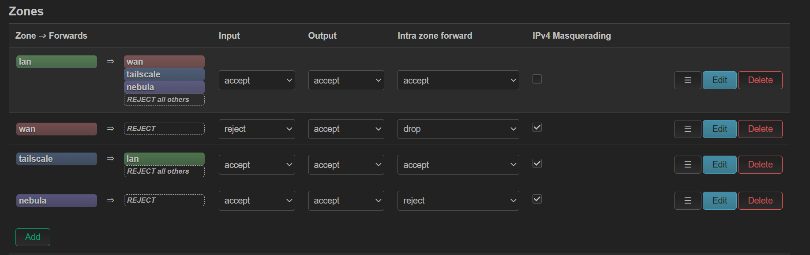

Das Gerät als Covered Device einzutragen ist der entscheidende Schritt:
Das Interface kommt in LuCI nie richtig „up“. Ohne diesen Eintrag hätte die
Zone kein Gerät, und Verkehr vom LAN ins Mesh würde abgewiesen.

#### DNS und Test

Anfragen für `*.ulno.mesh` leitet dnsmasq an `10.100.0.1` weiter, und
`ulno.mesh` steht als Ausnahme beim Rebind-Schutz. Sonst würde dnsmasq die
privaten `10.x`-Antworten verwerfen.

| Test | Ergebnis |
| --- | --- |
| Router: `ping vps.ulno.mesh` | `10.100.0.1` antwortet, 3 von 3, im Mittel 124 ms |
| Laptop: `ping ulno-oldplex02.hsbi01.ulno.mesh` | Name wird zu `10.100.1.11` aufgelöst, 3 von 3 Antworten |
| Laptop: Node-RED-Seite auf oldplex04 | HTTP 200 |

Die Ausgaben stehen im [Verbindungstest](evidence/nebula-verbindungstest-2026-11-20.txt).

## Discussion log

Beim Bundle hat uns der Professor geholfen, es per `croc` zu übertragen.
Unsere Ergebnisse haben wir in diesem Modul keiner Person aus einem anderen
Pod gezeigt.

## Remote proof

**Lernziele:** [LG1](#lg1), [LG4](#lg4)

Am 21.11.2026 lief der Router zu Hause. Statt eduroam nutzt er dort das
Heim-WLAN als Uplink (`homewwan`, `192.168.178.83`, Gateway FRITZ!Box).
An der Konfiguration von Nebula haben wir nichts geändert. `nebula1` hatte
wieder `10.100.0.22`.

| Test | Ergebnis |
| --- | --- |
| Router: `ping vps.ulno.mesh` | 5 von 5, im Mittel 103 ms |
| Router: `ping ulno-oldplex04.hsbi01.ulno.mesh` | 5 von 5, 31–35 ms |
| Router: `ping 10.100.1.1` | 5 von 5, 408–4296 ms |
| Laptop: `ping ulno-oldplex04.hsbi01.ulno.mesh` | 3 von 5, 36–67 ms, TTL 63 |
| Laptop: `ping ulno-oldplex02.hsbi01.ulno.mesh` | 4 von 5, 30–3051 ms, TTL 63 |
| Laptop: Node-RED `http://ulno-oldplex04.hsbi01.ulno.mesh:18083` | HTTP 200 nach 0,28 s |

Interessant ist der Unterschied zwischen den beiden Service-Hosts. Zu
oldplex04 lief der Tunnel auch von zu Hause direkt: Der Handshake kam von
`212.201.138.168:59190`, und die Zeiten waren mit 31–35 ms sehr gleichmäßig.
Zu oldplex01 meldet das Log dagegen „Send handshake via relay“ und eine
Antwort von `217.160.138.8:4545 (relayed)`. Diese Pakete liefen also über
den VPS, und die Zeiten lagen bei mehreren Sekunden. Die TTL von 63 auf dem
Laptop zeigt außerdem, dass der ganze Weg durchs Internet für ihn wie ein
einziger Hop aussieht, nämlich unser Router.

### Stolperstelle: Laptop zusätzlich am Heimrouter

Beim ersten Versuch kam vom Laptop keine Antwort, und Node-RED lief in den
Timeout. Der Laptop hing zu Hause zusätzlich per Kabel an der FRITZ!Box und
schickte Pakete für `10.100.x` über diese Standardroute statt über unseren
Router. Mit der WLAN-Adresse `192.168.14.29` als Absender (`ping -S`,
`curl --interface`) gingen die Pakete über `iotempire12` und den Router ins
Mesh, und alles war erreichbar.

Die Ausgaben stehen im [Remote-Protokoll](evidence/remote-proof-zuhause-2026-11-21.txt).

## MQTT through the overlay

<a id="task-2"></a>
### Aufgabe 2 – Node-RED erreichen und eine Nachricht bewegen

**Lernziele:** [LG4](#lg4)

#### Stolperstelle: Node-RED-Adresse

Bei den ersten Versuchen haben wir unser Node-RED nicht erreicht, weil wir
mehrere Zahlendreher in der Adresse hatten. Mit der richtigen Adresse
`http://ulno-oldplex04.hsbi01.ulno.mesh:18083` ging die Seite auf.

#### Flow

In Node-RED haben wir einen MQTT-Broker mit der Overlay-Adresse unseres
Routers angelegt: `10.100.0.22`, Port `1883`, ohne TLS und ohne Login.
Beide MQTT-Nodes nutzen diesen Broker.

| Node | Einstellung |
| --- | --- |
| `mqtt in` | Topic `pod12/#`, dahinter `debug 1` |
| `inject` | Payload `on` als String |
| `mqtt out` | Topic `pod12/iotempire12/set` |

Nach dem Deploy standen beide MQTT-Nodes auf „Verbunden“. Bei jedem Klick
auf den Inject erschien im Debug-Fenster `pod12/iotempire12/set` mit
`"on"`, das erste Mal um 14:02:42.

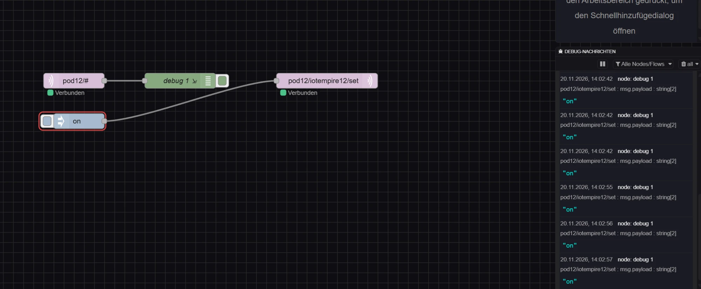

Die Nachricht hat damit den ganzen Weg in beide Richtungen genommen:
Node-RED schickt sie über das Overlay an den Broker auf unserem Router.
Der Broker liefert sie an alle Abonnenten von `pod12/#` aus, also über das
Overlay zurück an Node-RED. Auf dem Router war die MQTT-Verbindung von
`10.100.1.13` zu `10.100.0.22:1883` als `ESTABLISHED` zu sehen.

#### Stolperstelle: keine LED am Router

Im Kursblatt stand zu dem Zeitpunkt, dass wir eine LED oder einen Aktor
schalten sollen. Unser Router hat aber keine LED, die man über MQTT steuern
kann, und ein anderes Gerät hatten wir in diesem Modul nicht. Wir haben
deshalb nur mit der Debug-Ausgabe gearbeitet. In der aktuellen Fassung des
Kursblatts ist die Skulptur ausdrücklich simuliert, und es reicht, die
Nachricht in einem anderen Client ankommen zu sehen.

#### Pfadskizze

Die Skizze zeigt den Weg aus dem Kursblatt: Sensor → Pod-Broker → Overlay →
Node-RED → Overlay → Pod-Broker → Aktor. Sensor und Aktor haben wir nicht
aufgebaut. Getestet haben wir die Schritte ③ und ②: vom Inject über den
Broker zurück in die Debug-Ausgabe.

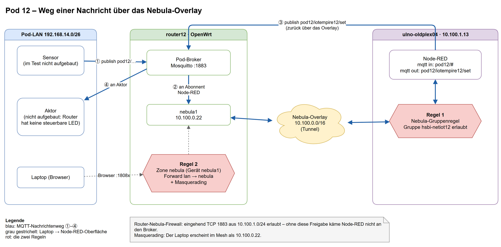

Diese zwei Regeln machen den Weg möglich:

1. **Gruppenregel auf dem Service-Host:** Unser Router-Zertifikat trägt die
   Gruppe `hsbi-netiot12`. Die Nebula-Firewall auf oldplex04 muss diese
   Gruppe durchlassen. Deren Konfiguration können wir nicht einsehen. Dass
   sie greift, zeigt die funktionierende Verbindung.
2. **Forward + Masquerade auf unserem Router:** Die Zone `nebula` erlaubt
   Forward von `lan` nach `nebula` und ersetzt die LAN-Adresse durch
   `10.100.0.22`. Nur so erreicht der Laptop die Node-RED-Seite, denn das
   Mesh nimmt nur Absenderadressen aus dem Zertifikat an.

Für MQTT braucht es auf unserer Seite noch eine dritte Freigabe: Die
`config.yml` des Routers erlaubt eingehend TCP `1883` aus `10.100.1.0/24`.
Ohne sie käme Node-RED nicht an unseren Broker.

Die Quelldatei ist [pfad-mqtt-overlay.drawio](diagrams/pfad-mqtt-overlay.drawio).

<a id="task-5"></a>
## Aufgabe 5 – Messen

**Lernziele:** [LG1](#lg1)

Gemessen haben wir am 20.11.2026 zwischen 14:37 und 14:45. Der Laptop war
per WLAN im Pod-LAN, der Router per eduroam am Campus. Jeder iperf3-Lauf
dauerte 10 Sekunden. Für die LAN-Basis lief `iperf3 -s -1` kurz auf dem
Router.

### Ping

| Strecke | min | Ø | max | Verlust |
| --- | ---: | ---: | ---: | ---: |
| Laptop → Router `192.168.14.1` | 2 ms | 6 ms | 12 ms | 0 % |
| Laptop → Router-Overlay `10.100.0.22` | 4 ms | 13 ms | 25 ms | 0 % |
| Router → Messhost `10.100.1.1` | 5,8 ms | 153 ms | 533 ms | 0 % |
| Laptop → Messhost `10.100.1.1` | 31 ms | 447 ms | 1989 ms | 0 % |
| Router → oldplex04 `10.100.1.13` | 7,1 ms | 91 ms | 269 ms | 0 % |
| Laptop → oldplex04 `10.100.1.13` | 30 ms | 323 ms | 673 ms | 0 % |
| Router → Lighthouse `10.100.0.1` | 18 ms | 183 ms | 686 ms | 0 % |

Je 10 Pakete. Die Rohdaten stehen in [ping-laptop](evidence/ping-laptop-2026-11-20.txt)
und [ping-router](evidence/ping-router-2026-11-20.txt).

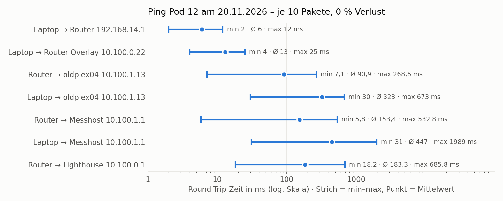

### Durchsatz

| Test | Befehl | Empfangen |
| --- | --- | ---: |
| LAN-Basis | `iperf3 -c 192.168.14.1 -t 10` | 60,5 Mbit/s |
| Overlay Uplink | `iperf3 -c 10.100.1.1 -t 10` | 2,47 Mbit/s |
| Overlay Downlink | `iperf3 -c 10.100.1.1 -t 10 -R` | 1,57 Mbit/s, 7 Retransmits |
| Overlay 4 Streams | `iperf3 -c 10.100.1.1 -t 10 -P 4` | 1,20 Mbit/s gesamt |

Die vollständigen Ausgaben stehen in [iperf3](evidence/iperf3-2026-11-20.txt).

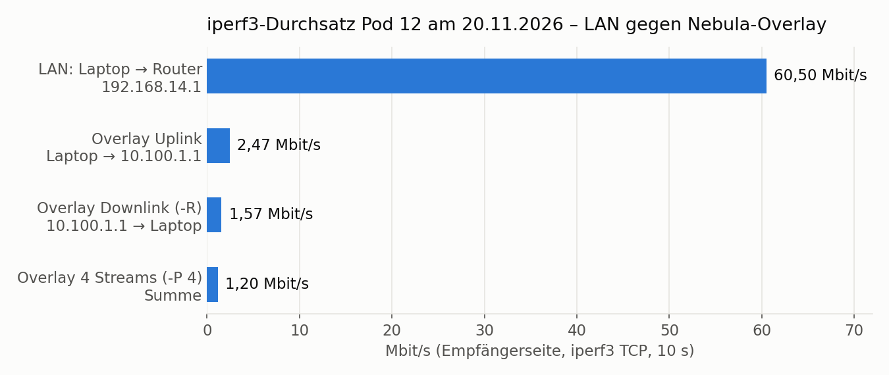

### Wo ist es schnell, wo langsam?

**Die zwei Zahlen:** etwa 60 Mbit/s im LAN gegen etwa 2,5 Mbit/s über das
Overlay. Bis zum Router bleibt alles im LAN. Selbst die Overlay-Adresse
`10.100.0.22` antwortet in 13 ms, weil sie auf dem Router selbst liegt.

Sobald ein Paket durch den Tunnel muss, wird es langsamer und vor allem
unregelmäßiger. Der beste Ping vom Router zum Messhost lag bei 5,8 ms. Der
Weg zum Cluster ist also kurz, er führt nicht über den VPS. Das passt zum
Log, nach dem der Tunnel direkt läuft und nicht über das Relay. Die
Mittelwerte von 90 bis 450 ms und die Ausreißer bis fast 2 s kommen
deshalb eher von der Funkstrecke: Der Router hängt per WLAN im eduroam, der
Laptop zusätzlich per WLAN am Router.

Beim Durchsatz bremst zusätzlich der Router. In einem 5-Sekunden-Kontrolllauf
brauchte der Nebula-Prozess 57 % CPU, insgesamt waren nur noch 27 % frei.
Der MT7628 mit seinem MIPS-Kern muss jedes Paket verschlüsseln. Vier
parallele Streams waren nicht schneller als einer. Auch das spricht für
eine Grenze am Router oder auf der Funkstrecke und nicht für eine einzelne
langsame TCP-Verbindung. Die [CPU-Abfrage](evidence/router-cpu-waehrend-iperf3-2026-11-20.txt)
liegt bei den Belegen.

**Wo das LAN aufhört:** an `nebula1`. Bis `10.100.0.22` bleiben die Zeiten
im LAN-Bereich. Ab `10.100.1.x` steigen Mittelwert und Streuung deutlich,
und der Durchsatz fällt auf ein Zwanzigstel.

### CGNAT und DS-Lite (optional)

Bei CGNAT teilen sich viele Kunden eine öffentliche IPv4-Adresse beim
Provider. Bei DS-Lite bekommt der Anschluss nur IPv6, und IPv4 läuft
getunnelt über ein solches Provider-NAT. In beiden Fällen sitzt vor dem
Knoten ein NAT, das man nicht selbst einstellen kann und das Ports oft für
jedes Ziel neu vergibt. Dann funktioniert Hole Punching oft nicht, und der
Verkehr muss über ein Relay. Ein normaler Heimrouter behält den Port für
ausgehende UDP-Pakete meist bei, deshalb klappt das Punchen dort in der
Regel.

## Reflexion

Meine Erfahrungen stehen in der [Reflexion zu Modul 3](../Reflections/ref03.md).

## Hilfsmittel und KI-Nutzung

Claude hat uns per SSH beim Router unterstützt: das Nebula-Paket
installiert, die Konfiguration ausgelesen (Overlay-Adresse, Firewall-Zonen,
Nebula-Firewall, Zertifikatsgruppe, Tunnel-Log) und erklärt, wie der Broker
in Node-RED eingetragen wird. Die Messungen aus Aufgabe 5 hat Claude auf
unseren Wunsch ausgeführt und dafür `iperf3` auf Router und Laptop
installiert. Auch die Tests für den Remote proof von zu Hause hat Claude
ausgeführt. Die draw.io-Zeichnungen, die Diagramme und die Texte sind
ebenfalls mit Claude entstanden. Alle Adressen, Zeiten und Messwerte stammen
aus den Router-Ausgaben, den Screenshots und den verlinkten Rohdaten vom
20. und 21.11.2026.
