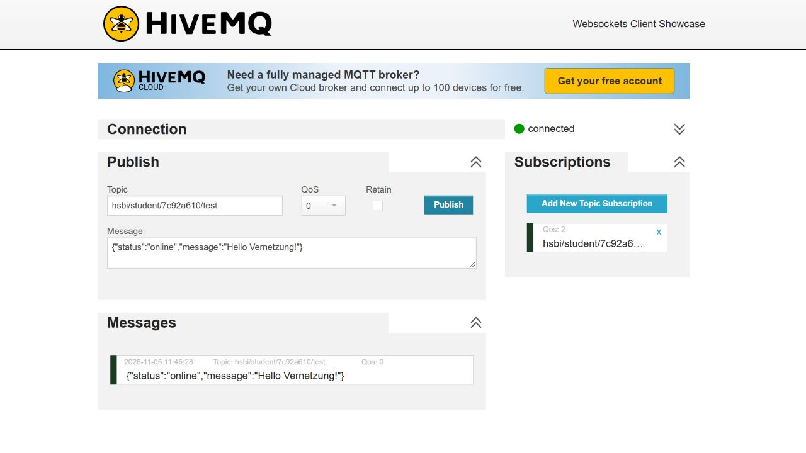

# MQTT-Test

**05.11.2026 · Einzelarbeit**

Für meinen ersten MQTT-Test habe ich den
[HiveMQ-Webclient](https://www.hivemq.com/demos/websocket-client/) verwendet.
Dafür musste ich keinen eigenen Broker installieren.

## Verbindung

| Einstellung | Wert |
| --- | --- |
| Broker | `broker.hivemq.com` |
| Transport | Sichere WebSockets, Port `8884` |
| Client-ID | `hsbi-prestudy-7c92a610` |
| Topic | `hsbi/student/7c92a610/test` |
| QoS beim Senden | 0 |
| QoS des Abonnements | 2 |
| Retain | Aus |
| Benutzername / Passwort | Nicht verwendet |

Im Guide stehen die Ports 1883 für TCP und 8000 für WebSockets.
Im HTTPS-Webclient war die verschlüsselte Verbindung über Port 8884
voreingestellt. Mit dieser Einstellung zeigte der Client `connected` an.

## Senden und Empfangen

Nach dem Verbinden habe ich das Topic `hsbi/student/7c92a610/test` abonniert.
Anschließend habe ich auf dasselbe Topic diese Nachricht gesendet:

```json
{"status":"online","message":"Hello Vernetzung!"}
```

Unter „Messages“ kam die Nachricht am 05.11.2026 um 11:45:28 Uhr an:



## Ergebnis

Ich habe meine eigene Nachricht über den Broker zurückbekommen. Der Weg war
Client → Broker → Client; ein zweites Gerät war nicht beteiligt.

Obwohl beim Abonnement QoS 2 eingestellt war, wurde die Nachricht mit QoS 0
empfangen. Ich hatte sie mit QoS 0 gesendet. Ein höher eingestelltes
Abonnement macht aus einer mit QoS 0 gesendeten Nachricht also keine
QoS-2-Nachricht. Die Laufzeit habe ich nicht gemessen.

Für diesen Versuch reichte der öffentliche Broker aus. Das Topic ist dort
aber nicht privat: Andere können es ebenfalls abonnieren. Deshalb habe ich
eine zufällige Kennung und nur eine Testnachricht verwendet. Die verschlüsselte
Verbindung schützt den Transport, aber nicht vor anderen Abonnenten.
